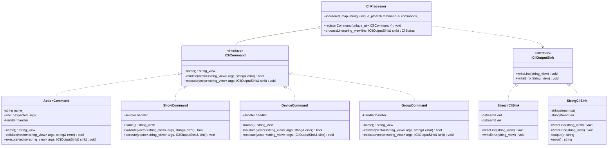

# Технические решения модуля CLI

Статус: проектирование. Основание — [spec.md](spec.md) и `AGENTS.md`.
Целевая платформа — Linux, Raspberry Pi 4b 8/120 (SD-card), C++17.

## 1. Архитектурная концепция

Модуль реализует классический паттерн «Команда» (Command Pattern) с реестром быстрого поиска.
Ключевая особенность: все команды унифицированы и начинаются с командного глагола
(`help`, `list`, `show`, `scan`, `save`, `exit`, `device`, `group`), что исключает
необходимость в fallback-парсерах и неоднозначных лексических правилах.

### 1.1. Диаграмма классов



---

## 2. Публичные интерфейсы C++17

### 2.1. Абстракция приёмника вывода (`ICliOutputSink.h`)

```cpp
namespace smart_home::cli {

class ICliOutputSink {
public:
    virtual ~ICliOutputSink() = default;
    virtual void writeLine(std::string_view line) = 0;
    virtual void writeError(std::string_view error) = 0;
};

class StreamCliSink : public ICliOutputSink {
public:
    StreamCliSink(std::ostream &out, std::ostream &err) : out_(out), err_(err) {}
    void writeLine(std::string_view line) override { out_ << line << '\n'; }
    void writeError(std::string_view error) override { err_ << error << '\n'; }

private:
    std::ostream &out_;
    std::ostream &err_;
};

class StringCliSink : public ICliOutputSink {
public:
    void writeLine(std::string_view line) override { out_ << line << '\n'; }
    void writeError(std::string_view error) override { err_ << error << '\n'; }

    std::string output() const { return out_.str(); }
    std::string error() const { return err_.str(); }
    void clear() { out_.str(""); err_.str(""); }

private:
    std::ostringstream out_;
    std::ostringstream err_;
};

} // namespace smart_home::cli
```

### 2.2. Интерфейс команды (`ICliCommand.h`)

```cpp
namespace smart_home::cli {

class ICliCommand {
public:
    virtual ~ICliCommand() = default;
    virtual std::string_view name() const noexcept = 0;
    virtual bool validate(const std::vector<std::string_view> &args, std::string &error) const = 0;
    virtual void execute(const std::vector<std::string_view> &args, ICliOutputSink &sink) = 0;
};

} // namespace smart_home::cli
```

### 2.3. Универсальная команда действия (`ActionCommand.h`)

```cpp
namespace smart_home::cli {

class ActionCommand : public ICliCommand {
public:
    using Handler = std::function<void(const std::vector<std::string_view> &args, ICliOutputSink &sink)>;

    ActionCommand(std::string name, std::size_t expected_args, Handler handler)
        : name_(std::move(name)), expected_args_(expected_args), handler_(std::move(handler)) {
        if (name_.empty())
            throw std::invalid_argument("Command name cannot be empty.");
        if (!handler_)
            throw std::invalid_argument("Command handler cannot be null.");
    }

    std::string_view name() const noexcept override { return name_; }

    bool validate(const std::vector<std::string_view> &args, std::string &error) const override {
        if (args.size() != expected_args_) {
            error = "Error: Command '" + name_ + "' expected " + std::to_string(expected_args_) + " arguments.";
            return false;
        }
        return true;
    }

    void execute(const std::vector<std::string_view> &args, ICliOutputSink &sink) override {
        handler_(args, sink);
    }

private:
    std::string name_;
    std::size_t expected_args_;
    Handler handler_;
};

} // namespace smart_home::cli
```

### 2.4. Процессор командной строки (`CliProcessor.h`)

```cpp
namespace smart_home::cli {

enum class CliStatus {
    Executed,
    EmptyInput,
    ValidationError,
    CommandNotFound
};

class CliProcessor {
public:
    CliProcessor() = default;
    CliProcessor(const CliProcessor &) = delete;
    CliProcessor &operator=(const CliProcessor &) = delete;
    CliProcessor(CliProcessor &&) noexcept = default;
    CliProcessor &operator=(CliProcessor &&) noexcept = default;

    void registerCommand(std::unique_ptr<ICliCommand> command) {
        if (!command)
            throw std::invalid_argument("Cannot register null command.");
        const std::string cmd_name(command->name());
        if (commands_.find(cmd_name) != commands_.end())
            throw std::invalid_argument("Command already registered: " + cmd_name);
        commands_.emplace(cmd_name, std::move(command));
    }

    CliStatus processLine(std::string_view line, ICliOutputSink &sink);

private:
    std::unordered_map<std::string, std::unique_ptr<ICliCommand>> commands_;
};

} // namespace smart_home::cli
```

---

## 3. Детали алгоритмов

### 3.1. Однократное разбиение на токены (`splitTokens`)
Строка разбивается на фрагменты `std::string_view` без создания временных `std::string`
и без динамических аллокаций памяти для содержимого слов:
```cpp
std::vector<std::string_view> splitTokens(std::string_view text) {
    std::vector<std::string_view> tokens;
    std::size_t start = 0;
    while (start < text.size()) {
        while (start < text.size() && std::isspace(static_cast<unsigned char>(text[start])))
            ++start;
        if (start >= text.size()) break;
        std::size_t end = start;
        while (end < text.size() && !std::isspace(static_cast<unsigned char>(text[end])))
            ++end;
        tokens.push_back(text.substr(start, end - start));
        start = end;
    }
    return tokens;
}
```

### 3.2. Алгоритм диспетчеризации в `processLine`
1. `tokens = splitTokens(line);`
2. Если `tokens.empty()` → возвращаем `CliStatus::EmptyInput`.
3. `cmd_name = std::string(tokens[0]);`
4. Поиск `auto it = commands_.find(cmd_name);` в `std::unordered_map`.
5. Если `it == commands_.end()`:
   - `sink.writeError("Error: Unknown command: " + cmd_name);`
   - возвращаем `CliStatus::CommandNotFound`.
6. Формирование вектора аргументов: `args = {tokens.begin() + 1, tokens.end()};`
7. Валидация:
   - `std::string error;`
   - `if (!it->second->validate(args, error)) { sink.writeError(error); return CliStatus::ValidationError; }`
8. Выполнение:
   - `it->second->execute(args, sink);`
   - возвращаем `CliStatus::Executed`.

---

## 4. Потокобезопасность и владение

- `CliProcessor` эксклюзивно владеет объектами `ICliCommand` через `std::unique_ptr`.
- Методы `validate` являются `const` и не имеют побочных эффектов.
- Команды stateless: все параметры приходят через `args`, внутреннее состояние между вызовами не сохраняется.
