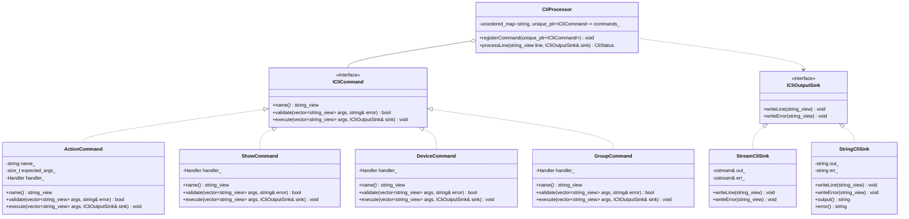

# Технические решения модуля CLI

Статус: реализовано. Основание — [spec.md](spec.md) и `AGENTS.md`.
Целевая платформа — Linux, Raspberry Pi 4b 8/120 (SD-card), C++17.

## 1. Архитектурная концепция

Модуль реализует классический паттерн «Команда» (Command Pattern) с реестром быстрого поиска.
Ключевая особенность: все команды унифицированы и начинаются с командного глагола
(`help`, `list`, `show`, `scan`, `save`, `exit`, `device`, `group`), что исключает
необходимость в fallback-парсерах и неоднозначных лексических правилах.

### 1.1. Диаграмма классов



---

## 2. Публичные интерфейсы C++17

### 2.1. Абстракция приёмника вывода (`ICliOutputSink.h`)

```cpp
namespace smart_home::cli {

class ICliOutputSink {
public:
    virtual ~ICliOutputSink() = default;
    virtual void writeLine(std::string_view line) = 0;
    virtual void writeError(std::string_view error) = 0;
};

class StreamCliSink : public ICliOutputSink {
public:
    StreamCliSink(std::ostream &out, std::ostream &err) : out_(out), err_(err) {}
    void writeLine(std::string_view line) override { out_ << line << '\n'; }
    void writeError(std::string_view error) override { err_ << error << '\n'; }

private:
    std::ostream &out_;
    std::ostream &err_;
};

class StringCliSink : public ICliOutputSink {
public:
    void writeLine(std::string_view line) override { out_.append(line).push_back('\n'); }
    void writeError(std::string_view error) override { err_.append(error).push_back('\n'); }

    std::string output() const { return out_; }
    std::string error() const { return err_; }
    void clear() noexcept { out_.clear(); err_.clear(); }

private:
    std::string out_;
    std::string err_;
};

} // namespace smart_home::cli
```

### 2.2. Интерфейс команды (`ICliCommand.h`)

```cpp
namespace smart_home::cli {

class ICliCommand {
public:
    virtual ~ICliCommand() = default;
    virtual std::string_view name() const noexcept = 0;
    virtual bool validate(const std::vector<std::string_view> &args, std::string &error) const = 0;
    virtual void execute(const std::vector<std::string_view> &args, ICliOutputSink &sink) = 0;
};

} // namespace smart_home::cli
```

### 2.3. Универсальная команда действия (`ActionCommand.h`)

```cpp
namespace smart_home::cli {

class ActionCommand : public ICliCommand {
public:
    using Handler = std::function<void(const std::vector<std::string_view> &args, ICliOutputSink &sink)>;

    ActionCommand(std::string name, std::size_t expected_args, Handler handler)
        : name_(std::move(name)), expected_args_(expected_args), handler_(std::move(handler)) {
        if (name_.empty())
            throw std::invalid_argument("Command name cannot be empty.");
        if (!handler_)
            throw std::invalid_argument("Command handler cannot be null.");
    }

    std::string_view name() const noexcept override { return name_; }

    bool validate(const std::vector<std::string_view> &args, std::string &error) const override {
        if (args.size() != expected_args_) {
            error = "Error: Command '" + name_ + "' expected " + std::to_string(expected_args_) + " arguments.";
            return false;
        }
        return true;
    }

    void execute(const std::vector<std::string_view> &args, ICliOutputSink &sink) override {
        handler_(args, sink);
    }

private:
    std::string name_;
    std::size_t expected_args_;
    Handler handler_;
};

} // namespace smart_home::cli
```

### 2.4. Процессор командной строки (`CliProcessor.h`)

```cpp
namespace smart_home::cli {

enum class CliStatus {
    Executed,
    EmptyInput,
    ValidationError,
    CommandNotFound
};

class CliProcessor {
public:
    CliProcessor() = default;
    CliProcessor(const CliProcessor &) = delete;
    CliProcessor &operator=(const CliProcessor &) = delete;
    CliProcessor(CliProcessor &&) noexcept = default;
    CliProcessor &operator=(CliProcessor &&) noexcept = default;

    void registerCommand(std::unique_ptr<ICliCommand> command);
    CliStatus processLine(std::string_view line, ICliOutputSink &sink);

private:
    std::unordered_map<std::string, std::unique_ptr<ICliCommand>> commands_;
};

} // namespace smart_home::cli
```

---

## 3. Детали алгоритмов

### 3.1. Однократное разбиение на токены

`nextToken` сдвигает `std::string_view` за очередной токен, пропуская
пробельные ASCII-символы. Вектор аргументов заимствует фрагменты исходной
строки. При регистрации имя команды проверяется как один непустой токен.

### 3.2. Алгоритм диспетчеризации в `processLine`
1. Прочитать имя команды через `nextToken`. При пустом вводе вернуть `EmptyInput`.
2. Найти команду в `std::unordered_map`. При отсутствии вывести `Error: Unknown command: <name>`
   и вернуть `CommandNotFound`.
3. Собрать остальные токены в вектор аргументов и вызвать `validate`.
4. При отклонении вывести диагностическое сообщение и вернуть `ValidationError`.
5. Вызвать `execute` и после возврата вернуть `Executed`.

### 3.3. Аргументы операций и обработчики

`ShowCommand` передаёт обработчику проверенный `DeviceId`. `DeviceCommand`
и `GroupCommand` используют общий разбор по `CapabilityCatalog` и передают
`DeviceOperation` с ID, видом операции и типизированными значениями. У RGB
три текстовых компонента преобразуются в одно значение `Color`. Групповой
обработчик также получает ID комнаты и категорию.

Обработчики runtime находят цели, выполняют операции через `CommandDispatcher`
и управляют снимками. Категорию по дескриптору и формат строк устройства
предоставляет `DeviceOutput.h`.

---

## 4. Потокобезопасность и владение

- `CliProcessor` эксклюзивно владеет объектами `ICliCommand` через `std::unique_ptr`.
- Методы `validate` являются `const` и не имеют побочных эффектов.
- Разбор использует данные текущего вызова. Обработчики могут хранить своё состояние.
- Вызывающий код сериализует регистрацию и обработку строк. Строка ввода и
  приёмник должны быть доступны на протяжении вызова `processLine`.
