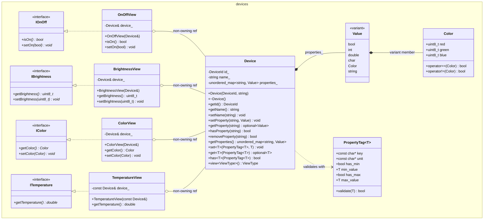
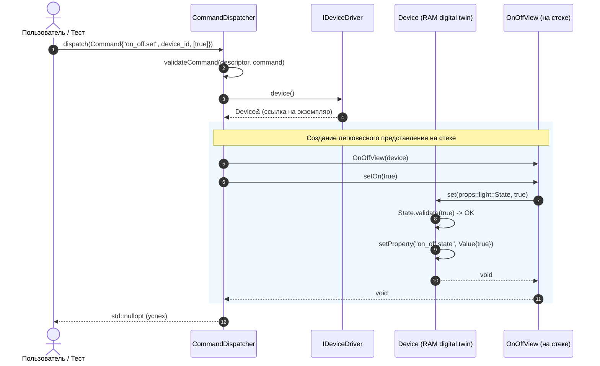

# Архитектурный дизайн: Рефакторинг модуля Devices

Статус: проектируемый архитектурный дизайн универсального цифрового двойника устройства, типизированных меток свойств и невладеющих представлений возможностей.  
Основание: [spec.md](spec.md), `AGENTS.md`, `specs/drivers/spec.md`, `specs/persistence/spec.md`, `specs/execution/spec.md`.  
Целевая платформа — Linux, Raspberry Pi 4b 8/120 (SD-card), стандарт C++17, модульная библиотека `SmartHome::Devices`.

---

## 1. Цели, границы и концепция универсального устройства

### 1.1. Проблемы существующей реализации
1. **Жесткая иерархия классов (Rigid Inheritance)**:
   Классы `Light` и `TemperatureSensor` жестко наследуют комбинацию интерфейсов (`Device, public IOnOff, public IBrightness, public IColor`). Добавление новой возможности (например, датчика присутствия или регулятора цветовой температуры) требует создания нового класса-наследника с множественным наследованием.
2. **Накладные расходы и хрупкость `dynamic_cast`**:
   Обработчики команд в `execution/src/handlers/` вынуждены выполнять `dynamic_cast<IOnOff*>(&device)`. В среде C++ это требует RTTI, обхода дерева типов во время выполнения и строкового сравнения mangled-типов, что неэффективно на процессоре ARM Cortex-A72 (Raspberry Pi 4).
3. **Сложность сериализации и персистентности**:
   Сохранение состояния устройства требовало ручного чтения каждого геттера конкретного подкласса. Невозможно обойти все параметры устройства динамически для записи в таблицу `device_properties` модуля `persistence`.
4. **Невозможность поддержки динамических устройств (Zigbee2MQTT)**:
   При обнаружении устройств Zigbee2MQTT со списком `exposes` невозможно заранее знать комбинацию возможностей устройства во время компиляции.

### 1.2. Концепция решения
1. **Единый цифровой двойник `Device`**:
   Класс `Device` становится универсальным контейнером состояния устройства в оперативной памяти (RAM digital twin). Состояние хранится в виде динамического словаря `std::unordered_map<std::string, Value>`. Жесткие подклассы `Light` и `TemperatureSensor` полностью удаляются.
2. **Типобезопасные метки свойств `PropertyTag<T>`**:
   Для исключения строковых ошибок опечаток и строгой статической типизации вводятся легковесные `constexpr`-метки `PropertyTag<T>`. Метка связывает строковый ключ (`"on_off.state"`), тип C++ (`bool`), допустимые границы (`min`/`max`) и единицу измерения (`unit`).
3. **Невладеющие представления возможностей (Views)**:
   Вместо множественного наследования устройством интерфейсов `IOnOff`, `IBrightness`, `IColor`, `ITemperature`, создаются стековые невладеющие представления (`OnOffView`, `BrightnessView`, `ColorView`, `TemperatureView`). Представление оборачивает ссылку `Device&` и реализует соответствующий интерфейс возможностей, транслируя вызовы методов в типобезопасные `device.set()` и `device.get()`.
4. **Бесшовная интеграция с `persistence` и `drivers`**:
   `Device::getProperties()` предоставляет полный снимок параметров для транзакционного сохранения через `DeviceStateStore::storeProperties`, а восстановление состояния выполняется простым наполнением словаря `Device::setProperty()`.

---

## 2. Архитектура классов и структура модуля

### 2.1. Файловая структура модуля
```text
devices/
  CMakeLists.txt
  include/devices/
    Device.h                  # Универсальный цифровой двойник устройства
    PropertyTag.h             # Шаблон типобезопасных меток и валидации диапазонов
    PropertyTags.h            # Стандартные дескрипторы свойств (props::light, climate, ...)
    types/
      Color.h                 # Структура Color (uint8_t red, green, blue)
      Value.h                 # Универсальный вариант Value (variant<bool, int, ...>)
    interfaces/
      IOnOff.h                # Контракт возможности включения/выключения
      IBrightness.h           # Контракт возможности регулировки яркости
      IColor.h                # Контракт возможности управления цветом
      ITemperature.h          # Контракт возможности чтения температуры
    views/
      OnOffView.h             # Непередающее владение представление IOnOff над Device&
      BrightnessView.h        # Представление IBrightness над Device&
      ColorView.h             # Представление IColor над Device&
      TemperatureView.h       # Представление ITemperature над const Device&
  src/
    Device.cpp                # Реализация базовых методов Device
    types/
      Color.cpp               # Утилиты работы с цветом и строковое представление
```

### 2.2. Архитектурная диаграмма классов (Mermaid)



---

## 3. Детальный дизайн компонентов

### 3.1. Тип `Value` (`devices/include/devices/types/Value.h`)
Тип `Value` переносится из модуля `command` в `devices`, так как состояние устройства является первичным по отношению к аргументам команд:
```cpp
namespace smart_home {

using Value = std::variant<bool, int, double, char, Color, std::string>;

} // namespace smart_home
```
Для сохранения 100% обратной совместимости файл `command/include/command/Value.h` становится прокси-заголовком, включающим `devices/types/Value.h`.

### 3.2. Шаблон `PropertyTag<T>` и C++17 `constexpr` специализация
В C++17 класс `std::string` не является литеральным типом (его конструкторы и деструкторы не могут выполняться в `constexpr` контексте). Для обеспечения чистой константности `constexpr` без динамических аллокаций шаблон разделяется на общую реализацию для арифметических типов и специализацию для неарифметических типов:

```cpp
namespace smart_home {

template <typename T>
struct PropertyTag {
    static_assert(
        std::is_same_v<T, bool> || std::is_same_v<T, int> ||
        std::is_same_v<T, double> || std::is_same_v<T, char> ||
        std::is_same_v<T, Color> || std::is_same_v<T, std::string>,
        "PropertyTag T must be a supported Value type");

    using Type = T;

    const char *key;
    const char *unit{""};
    bool has_min{false};
    T min_value{};
    bool has_max{false};
    T max_value{};

    constexpr PropertyTag(const char *k, const char *u = "") noexcept
        : key(k), unit(u), has_min(false), min_value{}, has_max(false), max_value{} {}

    constexpr PropertyTag(const char *k, T min_v, T max_v, const char *u = "") noexcept
        : key(k), unit(u), has_min(true), min_value(min_v), has_max(true), max_value(max_v) {}

    constexpr bool validate(const T &val) const noexcept {
        if (has_min && val < min_value)
            return false;
        if (has_max && val > max_value)
            return false;
        return true;
    }
};

// Специализация для std::string (литеральный тип в C++17)
template <>
struct PropertyTag<std::string> {
    using Type = std::string;

    const char *key;
    const char *unit{""};

    constexpr explicit PropertyTag(const char *k, const char *u = "") noexcept
        : key(k), unit(u) {}

    bool validate(const std::string &) const noexcept { return true; }
};

// Специализация для Color (нет понятия min/max диапазона)
template <>
struct PropertyTag<Color> {
    using Type = Color;

    const char *key;
    const char *unit{""};

    constexpr explicit PropertyTag(const char *k, const char *u = "") noexcept
        : key(k), unit(u) {}

    bool validate(const Color &) const noexcept { return true; }
};

} // namespace smart_home
```

### 3.3. Стандартные свойства `PropertyTags.h`
Объявляются в пространстве `smart_home::props` с ключевым словом `inline constexpr` (стандарт C++17), что гарантирует ODR (One Definition Rule) и отсутствие накладных расходов:
```cpp
namespace smart_home::props {

namespace light {
    inline constexpr PropertyTag<bool> State{"on_off.state"};
    inline constexpr PropertyTag<int> Brightness{"brightness.level", 0, 100, "%"};
    inline constexpr PropertyTag<Color> Rgb{"color.rgb"};
}

namespace climate {
    inline constexpr PropertyTag<double> Temperature{"temperature.celsius", -50.0, 100.0, "°C"};
    inline constexpr PropertyTag<double> Humidity{"humidity.percent", 0.0, 100.0, "%"};
    inline constexpr PropertyTag<double> TargetTemperature{"climate.target_celsius", 5.0, 35.0, "°C"};
    inline constexpr PropertyTag<int> Co2{"co2.ppm", 0, 5000, "ppm"};
}

namespace security {
    inline constexpr PropertyTag<bool> Motion{"motion.detected"};
    inline constexpr PropertyTag<bool> Contact{"contact.open"};
    inline constexpr PropertyTag<bool> Tamper{"security.tamper"};
    inline constexpr PropertyTag<int> Battery{"battery.level", 0, 100, "%"};
}

namespace power {
    inline constexpr PropertyTag<double> Voltage{"power.voltage", 0.0, 300.0, "V"};
    inline constexpr PropertyTag<double> Current{"power.current", 0.0, 32.0, "A"};
    inline constexpr PropertyTag<double> PowerWatts{"power.active_power", 0.0, 10000.0, "W"};
}

} // namespace smart_home::props
```

### 3.4. Класс `Device`
Универсальный класс устройства:
- Не копируется (`delete` copy constructor и copy assignment).
- Разрешено перемещение (`move-only`).
- Методы:
  - `getId() const noexcept -> DeviceId`
  - `getName() const -> std::string`
  - `setName(std::string)` (валидация на непустую строку).
  - Сырые методы работы со словарем:
    - `setProperty(const std::string &key, Value val)`: проверяет `key.empty()`, вставляет или перезаписывает.
    - `getProperty(const std::string &key) const -> std::optional<Value>`: проверяет `key.empty()`.
    - `hasProperty(const std::string &key) const -> bool`: проверяет `key.empty()`.
    - `removeProperty(const std::string &key) -> bool`: удаляет свойство, возвращает `true` если ключ существовал.
    - `getProperties() const noexcept -> const std::unordered_map<std::string, Value>&`.
  - Типобезопасные методы:
    - `set(const PropertyTag<T> &tag, const T &value)`: вызывает `tag.validate(value)`, при выходе за пределы выбрасывает `std::invalid_argument` без модификации словаря (**Strong Exception Guarantee**).
    - `get(const PropertyTag<T> &tag) const -> std::optional<T>`: возвращает `std::nullopt`, если ключа нет или тип в `Value` не совпадает с `T`.
    - `has(const PropertyTag<T> &tag) const -> bool`.
    - `view<ViewType>()` и `view<ViewType>() const`.

### 3.5. Непередающие владение представления (Views)
Представления конструируются на стеке над ссылкой `Device&` и проецируют интерфейсы возможностей:

#### `OnOffView` (реализует `IOnOff`):
```cpp
class OnOffView : public IOnOff {
public:
    explicit OnOffView(Device &device) noexcept : device_(device) {}

    bool isOn() const override {
        auto val = device_.get(props::light::State);
        if (!val.has_value())
            throw std::logic_error("Device does not possess 'on_off.state' property");
        return *val;
    }

    void setOn(bool on) override {
        device_.set(props::light::State, on);
    }

private:
    Device &device_;
};
```

#### `BrightnessView` (реализует `IBrightness`):
```cpp
class BrightnessView : public IBrightness {
public:
    explicit BrightnessView(Device &device) noexcept : device_(device) {}

    std::uint8_t getBrightness() const override {
        auto val = device_.get(props::light::Brightness);
        if (!val.has_value())
            throw std::logic_error("Device does not possess 'brightness.level' property");
        return static_cast<std::uint8_t>(*val);
    }

    void setBrightness(std::uint8_t brightness) override {
        // tag.validate() проверит диапазон [0; 100] и выбросит invalid_argument при нарушении
        device_.set(props::light::Brightness, static_cast<int>(brightness));
    }

private:
    Device &device_;
};
```

#### `ColorView` (реализует `IColor`):
```cpp
class ColorView : public IColor {
public:
    explicit ColorView(Device &device) noexcept : device_(device) {}

    Color getColor() const override {
        auto val = device_.get(props::light::Rgb);
        if (!val.has_value())
            throw std::logic_error("Device does not possess 'color.rgb' property");
        return *val;
    }

    void setColor(Color color) override {
        device_.set(props::light::Rgb, color);
    }

private:
    Device &device_;
};
```

#### `TemperatureView` (реализует `ITemperature`):
```cpp
class TemperatureView : public ITemperature {
public:
    explicit TemperatureView(const Device &device) noexcept : device_(device) {}

    double getTemperature() const override {
        auto val = device_.get(props::climate::Temperature);
        if (!val.has_value())
            throw std::logic_error("Device does not possess 'temperature.celsius' property");
        return *val;
    }

private:
    const Device &device_;
};
```

---

## 4. Сквозной сценарий диспетчеризации команд (Sequence Diagram)



---

## 5. Анализ ресурсов и памяти на Raspberry Pi 4b

1. **Размер объектов в оперативной памяти (ARMv8 64-bit)**:
   - `sizeof(Value)` = 40 байт (наибольший тип `std::string` 32 байта + 1 байт дискриминатор + выравнивание до 8 байт).
   - `sizeof(Device)` = 8 байт (`DeviceId`) + 32 байта (`std::string name`) + 56 байт (`std::unordered_map`) = **96 байт**.
   - `sizeof(OnOffView)` = **8 байт** (одна ссылка `Device&`). Представление размещается исключительно на стеке функции обработки команды и имеет нулевой оверхед по динамической памяти.
2. **Исключение `dynamic_cast`**:
   - Старая схема: `dynamic_cast<IOnOff*>(&device)` вызывала рантайм-поиск в RTTI с блокировками типов и накладными расходами CPU.
   - Новая схема: создание `OnOffView(device)` не содержит виртуальных таблиц приведения и компилируется в прямые инлайн-вызовы методов `Device::set`.
3. **Хранение `PropertyTag`**:
   - Все стандартные теги `props::*` объявлены как `inline constexpr` и размещаются компоновщиком в секции констант `.rodata` исполняемого файла, занимая суммарно менее 1 КБ памяти без аллокаций в куче.

---

## 6. Гарантии безопасности исключений

| Метод | Условие сбоя | Тип исключения | Состояние объекта после сбоя |
|---|---|---|---|
| `setProperty(key, val)` | `key.empty()` | `std::invalid_argument` | Не изменяется (Basic Guarantee) |
| `getProperty(key)` | `key.empty()` | `std::invalid_argument` | Не изменяется (No-throw read) |
| `set(tag, value)` | Выход за пределы `[min; max]` | `std::invalid_argument` | **Строгая гарантия (Strong Guarantee)**: словарь не изменяется |
| `get(tag)` | Свойство отсутствует или тип не совпадает | Нет исключений (`noexcept` логика) | Возвращает `std::nullopt` |
| `View::get*()` | Свойство отсутствует в `Device` | `std::logic_error` | Не изменяется |
| `View::set*()` | Нарушение диапазона | `std::invalid_argument` | Прежнее состояние сохраняется |
| `setName(name)` | `name.empty()` | `std::invalid_argument` | Прежнее имя сохраняется |
