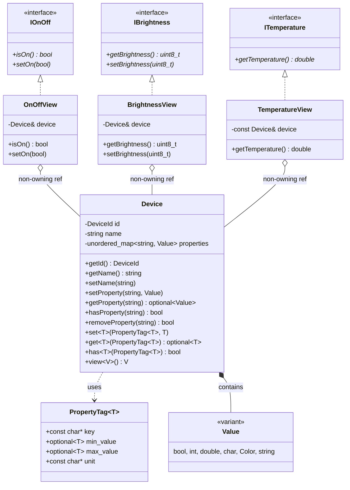

# Архитектурный дизайн: Модуль Devices

ID: Devices-Design

## Архитектура и структура классов



## Жизненный цикл и интеграция компонентов

1. **Создание устройства драйвером**:
   - Драйвер (`SimulatedLightDriver`) создает экземпляр `Device(local_id, name)`.
   - Через `device.set(props::light::State, false)`, `device.set(props::light::Brightness, 50)` драйвер наполняет устройство начальным состоянием.
   - Драйвер формирует `DeviceDescriptor`, описывающий поддерживаемые операции (`on_off.set`, `on_off.get`, `brightness.set`, `brightness.get`).

2. **Диспетчеризация команд (`execution`)**:
   - Обработчик команды (`OnOffHandlers.cpp`) получает ссылку `Device&` от драйвера.
   - Вместо вызова `dynamic_cast<IOnOff*>(&device)` обработчик обращается к представлению:
     ```cpp
     OnOffView view(device);
     view.setOn(command_argument_value);
     ```
     или напрямую к типизированному свойству:
     ```cpp
     if (!device.has(props::light::State))
         throw std::logic_error("Device does not support on_off.state");
     device.set(props::light::State, command_argument_value);
     ```

3. **Связь с Онтологией и Инвентарем**:
   - Онтология хранит связи топологии (`HAS_FEATURE -> on_off`, `HAS_FEATURE -> brightness`).
   - Имена свойств `props::light::State.key` (`"on_off.state"`) согласованы с префиксами возможностей онтологии (`"on_off"`).
   - В SQLite сохраняются пары `(local_id, property_key, value)`.

## Потоковая модель и ограничения памяти на Raspberry Pi 4

- `Device` не содержит собственных мьютексов и потоков; доступ к объекту устройства сериализуется на уровне драйвера или вызывающего цикла `runtime`.
- Экземпляры `PropertyTag<T>` являются `constexpr` и в скомпилированном бинарном файле занимают место в секции `.rodata` без выделений памяти в куче.
- Метод `view<T>()` создает временную обертку на стеке с размером в один указатель (`sizeof(void*) = 8` байт на 64-битном ARMv8 / Raspberry Pi OS 64-bit).
