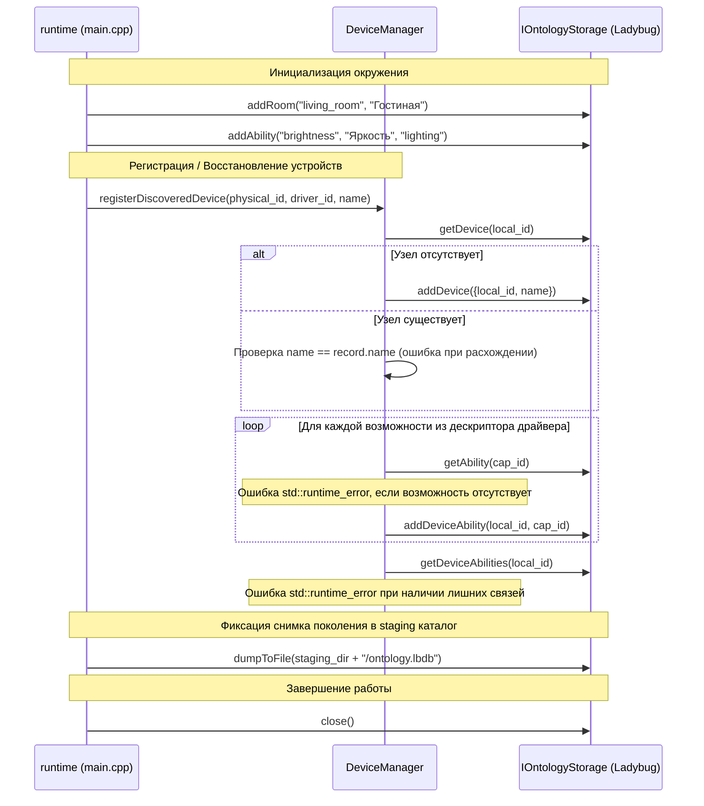

# Технические решения модуля ontology

Статус: согласовано со спецификацией [spec.md](spec.md) и спецификацией [specs/device_management/spec.md](../device_management/spec.md).  
Основание: `specs/ontology/spec.md`, `specs/storage/spec.md`, `specs/device_management/spec.md`, `AGENTS.md`.
Целевая платформа — Linux, Raspberry Pi 4b 8/120 (SD-card), публичный API C++17, внутренняя реализация на LadybugDB C++ SDK.

## 1. Цели, границы и концепция Capability-Based

Модуль `ontology` инкапсулирует графовую базу данных LadybugDB для представления семантической топологии комнат, устройств и возможностей умного дома, а также связей между ними.

### Модель возможностей (Capability-Based)
В соответствии со спецификацией модуля `device_management`:
- **Устройства не имеют статической категории/типа**: поле `type` исключено из узла `devices`.
- Назначение, класс и операции устройства определяются динамически набором связей `HAS_FEATURE` с записями каталога возможностей (`abilities`).
- Запросы устройств по их роли выполняются через поиск связей с возможностями (`getDevicesWithAbility(ability_id)`), например, поиск всех устройств с возможностью `brightness` вместо поиска по устаревшему строковому типу `"light"`.

### Границы ответственности
- **Входит в зону ответственности**:
  - Хранение семантического графа узлов (`rooms`, `devices`, `abilities`) и ориентированных связей (`LOCATED_IN`, `HAS_FEATURE`).
  - Обеспечение ограничений графа: не более одной комнаты на устройство (`LOCATED_IN`), отсутствие дубликатов связей `HAS_FEATURE`, сериализация запросов одного экземпляра через `transactionMutex`.
  - Изоляция рабочей базы в памяти (`/dev/shm`, POSIX tmpfs) и надежный протокол фиксации снимков на диск через `dumpToFile(path)` (`CHECKPOINT -> copy -> fsync -> rename -> fsync`).
  - Межпроцессная блокировка файла базы данных через `flock` (.lock файл).
  - Предоставление транзакционных методов CRUD для сущностей и связей.
  - Явное завершение жизненного цикла через `close()` с опциональным автодампом в `dump_path`.

- **Не входит в зону ответственности**:
  - Синхронизация инвентаря SQLite с графом и валидация соответствия драйверам — выполняется в `SmartHome::DeviceManagement` (`DeviceManager`).
  - Создание комнат и первичное наполнение каталога возможностей — выполняется в `runtime` (`src/main.cpp`).
  - Хранение физических адресов оборудования (`physical_id`) и привязок к фабрикам драйверов (`driver_id`) — остаётся в `IDeviceStorage`.
  - Хранение оперативных runtime-значений возможностей (текущая яркость, цвет, температура) — управляется в `runtime`.
  - Фоновые потоки периодического сохранения и таймеры (полностью исключены из модуля; управление моментами сохранения принадлежит приложению).

## 2. Архитектура интерфейса и структуры данных

### Структуры данных
Файл: `ontology/include/ontology/OntologyRecords.h`

```cpp
namespace smart_home::ontology {

struct RoomRecord {
    std::string id;   ///< Ключ комнаты (slug/UUID, напр. "living_room").
    std::string name; ///< Название комнаты ("Гостиная").

    bool operator==(const RoomRecord &other) const noexcept {
        return id == other.id && name == other.name;
    }
};

struct OntologyDeviceRecord {
    DeviceId id;      ///< Локальный ключ (совпадает с DeviceRecord.local_id).
    std::string name; ///< Название устройства ("Потолочная лампа").

    bool operator==(const OntologyDeviceRecord &other) const noexcept {
        return id == other.id && name == other.name;
    }
};

struct AbilityRecord {
    std::string id;       ///< Ключ возможности (CapabilityDescriptor::getId()).
    std::string name;     ///< Название ("Яркость").
    std::string category; ///< Категория ("lighting", "climate").

    bool operator==(const AbilityRecord &other) const noexcept {
        return id == other.id && name == other.name && category == other.category;
    }
};

struct DeviceOntologyDetails {
    OntologyDeviceRecord device;          ///< Запись устройства (id, name).
    std::string room_id;                  ///< Ключ комнаты; пустой при отсутствии связи.
    std::vector<std::string> ability_ids; ///< Отсортированные ключи возможностей.
};

} // namespace smart_home::ontology
```

### Конфигурация `OntologyConfig`
Файл: `ontology/include/ontology/OntologyConfig.h`

```cpp
namespace smart_home::ontology {

struct OntologyConfig {
    std::string database_path = "data/home_ontology.lbdb"; ///< Исходная база для открытия/загрузки.
    std::string dump_path = {};                            ///< Назначение автодампа при close(); если пустой — автодамп отключен.
    std::string ram_workspace_base = "/dev/shm";           ///< Родитель закрытого рабочего каталога.
    std::size_t max_buffer_pool_bytes = 64 * 1024 * 1024;  ///< Буфер движка, байты.
    std::size_t max_threads = 2;                           ///< Число потоков движка.
    bool allow_disk_fallback = false;                      ///< Разрешить рабочую копию на диске при недоступности RAM.
};

} // namespace smart_home::ontology
```

### Публичный контракт `IOntologyStorage`
Файл: `ontology/include/ontology/IOntologyStorage.h`

Класс `IOntologyStorage` объявляет чисто виртуальные методы управления комнатами, устройствами, возможностями, связями и снимками:
- Комнаты: `addRoom`, `getRoom`, `getAllRooms`, `deleteRoom`.
- Устройства: `addDevice(OntologyDeviceRecord)`, `getDevice(DeviceId)`, `getAllDevices`, `deleteDevice(DeviceId)`.
- Возможности: `addAbility(AbilityRecord)`, `getAbility(std::string)`, `getAllAbilities`, `deleteAbility(std::string)`.
- Связи комнат: `assignDeviceToRoom(DeviceId, room_id)`, `removeDeviceFromRoom(DeviceId)`, `getDeviceRoom(DeviceId)`, `getDevicesInRoom(room_id)`.
- Связи возможностей: `addDeviceAbility(DeviceId, ability_id)`, `removeDeviceAbility(DeviceId, ability_id)`, `getDeviceAbilities(DeviceId)`, `getDevicesWithAbility(ability_id)`.
- Составные снимки: `getDeviceDetails(DeviceId)`.
- Управление снимками и завершение:
  ```cpp
  virtual void dumpToFile(const std::string &path) = 0;
  virtual void close() = 0;
  ```

Контракт `dumpToFile(path)` и `close()` полностью унифицирован с `IDeviceStorage`.

## 3. Схема данных LadybugDB и запросы Cypher

### Схема таблиц LadybugDB
При инициализации базы данных создаются таблицы узлов и связей:

```cypher
CREATE NODE TABLE rooms(id STRING, name STRING, PRIMARY KEY(id));
CREATE NODE TABLE devices(id INT64, name STRING, PRIMARY KEY(id));
CREATE NODE TABLE abilities(id STRING, name STRING, category STRING, PRIMARY KEY(id));
CREATE REL TABLE LOCATED_IN(FROM devices TO rooms);
CREATE REL TABLE HAS_FEATURE(FROM devices TO abilities);
```

Проверка схемы требует точного совпадения полей и первичных ключей.
Старая таблица `devices(id, name, type)` несовместима: открытие завершается
ошибкой с требованием явной миграции.

### Основные операции Cypher
1. **Добавление/обновление устройства**:
   ```cypher
   MERGE (d:devices {id: $id}) SET d.name = $name
   ```
2. **Привязка к комнате (с гарантией единственности)**:
   ```cypher
   MATCH (d:devices {id: $device_id})-[r:LOCATED_IN]->(:rooms) DELETE r;
   MATCH (d:devices {id: $device_id}), (rm:rooms {id: $room_id})
   CREATE (d)-[:LOCATED_IN]->(rm);
   ```
3. **Привязка к возможности (идемпотентная)**:
   ```cypher
   MATCH (d:devices {id: $device_id}), (a:abilities {id: $ability_id})
   MERGE (d)-[:HAS_FEATURE]->(a);
   ```
4. **Поиск устройств по возможности (Capability-Based селекция)**:
   ```cypher
   MATCH (d:devices)-[:HAS_FEATURE]->(a:abilities {id: $ability_id})
   RETURN d.id, d.name ORDER BY d.id;
   ```
5. **Согласованный снимок деталей устройства**:
   ```cypher
   MATCH (d:devices {id: $device_id})
   OPTIONAL MATCH (d)-[:LOCATED_IN]->(r:rooms)
   OPTIONAL MATCH (d)-[:HAS_FEATURE]->(a:abilities)
   RETURN d.id, d.name, r.id, a.id ORDER BY a.id;
   ```

Все аргументы передаются исключительно через параметры запросов (`$id`, `$name` и т.д.), предотвращая инъекции Cypher.

## 4. Взаимодействие с `DeviceManager` и `runtime`



## 5. Файловый протокол RAM-First и долговечность

1. **Изоляция в RAM**:
   - При создании экземпляра постоянный `.lbdb` файл (если существует) копируется в приватный каталог под `/dev/shm` (права `0700`).
   - Все запросы приложения выполняются в оперативной памяти, исключая износ flash/SD-носителя.
2. **Эксклюзивный доступ**:
   - До открытия базы захватывается неблокирующий `flock` на ассоциированный файл `<database_path>.lock`.
   - Наличие второго писателя приводит к немедленному отказу запуска.
Относительные пути конфигурации фиксируются при создании экземпляра.
Явный dump не перенастраивает финальный путь и выполняется даже без изменений.

3. **Протокол создания снимка (`dumpToFile(path)`)**:
   - Захват мьютекса сериализации операций `transactionMutex`.
   - Проверка состояния `requireOpen()`.
   - Валидация пути `path`: существующий родитель, отсутствие симлинков,
     жёстких ссылок, путей в рабочем каталоге и псевдонимов lockfile.
     Исключительный доступ к назначению обеспечивает вызывающий код.
   - Выполнение `CHECKPOINT` в LadybugDB для сброса WAL в основной файл рабочей базы в RAM.
   - Закрытие подключения движка к рабочей копии.
   - Копирование рабочего файла в уникальный временный файл рядом с файлом назначения (`.<filename>.tmp_XXXXXX`).
   - `fsync` временного файла.
   - Атомарный `rename` временного файла поверх файла назначения `path`.
   - `fsync` родительского каталога файла назначения.
   - Повторное открытие подключения к рабочей базе в RAM.
4. **Завершение работы (`close()`)**:
   - Захват мьютекса закрытия `closeMutex`.
   - Если уже закрыт — возврат (идемпотентность).
   - Под `transactionMutex`, если задан `dump_path`, выполняется внутренний
     протокол dump без повторного открытия после успеха. Публичный метод
     не вызывается рекурсивно под тем же mutex. При неудаче финального dump
     объект остаётся доступным для повторного `close()`.
   - Закрытие базы LadybugDB и удаление временного каталога в `/dev/shm`.
   - Снятие блокировки `flock`.
   - Установка `closed_ = true`.

## 6. Логирование и обработка ошибок

- Модуль использует фасад `smart_home::logging::log`.
- Фоновые потоки отсутствуют, ошибки фонового сохранения исключены.
- Ошибки явного вызова `dumpToFile(path)` или `close()` пробрасываются вызывающему коду без маскирования как `std::runtime_error`.
- Вызовы операций после `close()` выбрасывают `std::logic_error`.
- Деструктор гарантирует отсутствие исключений (`noexcept`), при неудаче логирует `Critical` и оставляет файлы рабочей копии в RAM для аварийного восстановления.
