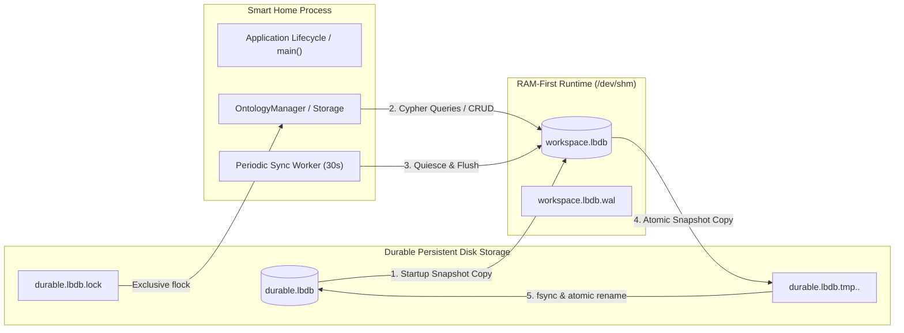
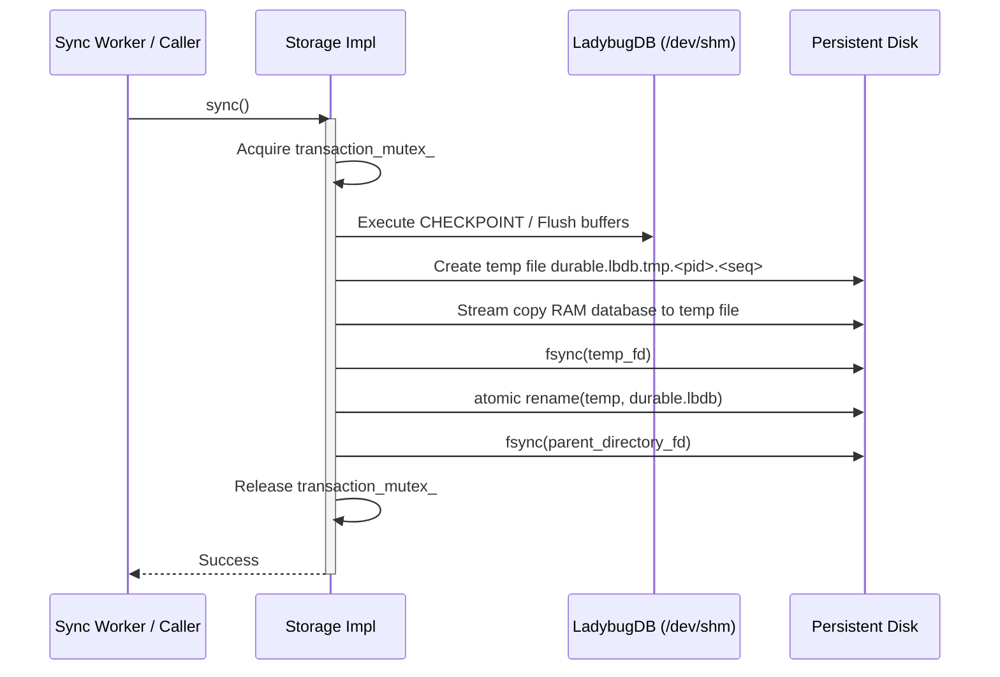

# Architecture & Implementation Plan: LadybugDB Home Ontology Integration

This document defines the architectural specification and implementation plan for integrating LadybugDB graph database capabilities into the `smart_home` system to represent and query the home's ontology (rooms, devices, abilities, and their topological relations).

---

## 1. Executive Summary & Architectural Overview

The smart home platform currently relies on relational and key-value storage (`SmartHome::Storage` with SQLite / in-memory backends) for physical device discovery records and runtime driver registry binding. While efficient for device inventory, flat tables cannot natively capture semantic topology, room containment hierarchies, or device capability associations without complex relational joins.

This enhancement introduces a dedicated, decoupled module: **`SmartHome::Ontology`** (`ontology/`). It embeds LadybugDB to manage a property graph ontology containing:
* **Node Tables**: `rooms`, `devices`, `abilities`
* **Relationship Tables**: `LOCATED_IN` (directed from `devices` to `rooms`), `HAS_FEATURE` (directed from `devices` to `abilities`)

To optimize high-throughput operational queries and minimize wear on persistent flash/NVMe storage, the database runtime implements a **RAM-First Workspace Pattern**:
1. At application startup, the persistent `.lbdb` database file is copied to an isolated, secure per-process workspace under `/dev/shm/` (Linux POSIX shared memory tmpfs).
2. The application opens and operates exclusively on the `/dev/shm` RAM instance.
3. A background synchronization worker, augmented by manual `sync()` triggers and an explicit shutdown sequence, commits atomic, durable snapshots back to the persistent disk destination.
4. An OS-level file lock guarantees single-writer exclusion across the entire persistent database lifecycle.



---

## 2. Proposed Defaults & Architectural Decisions

To prevent blocking implementation on unresolved options, the following defaults are adopted:

1. **Storage Coexistence & Identifier Alignment**:
   * `IDeviceStorage` (`SmartHome::Storage`) remains the source of truth for physical hardware descriptors (`physical_id`, `driver_id`, assigned local `DeviceId`).
   * `SmartHome::Ontology` uses `smart_home::DeviceId` (`std::int64_t`) as the primary key for the `devices` node table.
   * `abilities` use `CapabilityDescriptor::getId()` (`std::string`, e.g., `"brightness"`, `"temperature"`) as primary keys.
   * `rooms` use an explicit alphanumeric slug or UUID string (`std::string`, e.g., `"living_room"`, `"kitchen"`).
2. **Copy Direction & Crash Window**:
   * Direction is strictly unidirectional at startup (**Disk -> RAM**) and unidirectional during operation (**RAM -> Disk**).
   * No bidirectional merge is attempted. Leftover files in `/dev/shm` from crashed sessions are never preferred over persistent disk; any unsaved state in a hard crash is bounded by the synchronization window.
   * Default periodic sync interval: **30 seconds** (configurable; set `0` to disable periodic sync and rely on manual/shutdown sync).
3. **SDK Compatibility & Language Standard Boundary**:
   * The core `smart_home` project targets C++17. If the prebuilt `liblbug.a` requires C++20 ABI/symbols, the `smart_home_ontology` module compiles with `cxx_std_20` (or wraps the C API `lbug.h`) while exposing a strictly C++17-compliant public interface via PIMPL.
   * Ladybug SDK path is resolved through `SMART_HOME_LADYBUG_SDK_DIR` (CMake cache) or the `LADYBUG_SDK_DIR` environment variable, never hardcoded.
4. **Relationship Cardinality & Deletion Cascades**:
   * `LOCATED_IN`: A device may belong to at most **one** room. Assigning a device to a new room automatically drops any pre-existing `LOCATED_IN` edge.
   * `HAS_FEATURE`: A device may link to multiple abilities; duplicate edges between the same pair are idempotent no-ops.
   * Deleting a device node cascades to delete its incident `LOCATED_IN` and `HAS_FEATURE` edges.
   * Deleting a room detaches resident devices (drops `LOCATED_IN` edges) without deleting the device nodes themselves.

---

## 3. Cypher Graph Schema Definition

LadybugDB DDL statements are executed idempotently at initial database creation.

```cypher
// Node tables
CREATE NODE TABLE rooms(
    id STRING,
    name STRING,
    PRIMARY KEY(id)
);

CREATE NODE TABLE devices(
    id INT64,
    name STRING,
    type STRING,
    PRIMARY KEY(id)
);

CREATE NODE TABLE abilities(
    id STRING,
    name STRING,
    category STRING,
    PRIMARY KEY(id)
);

// Relationship tables
CREATE REL TABLE LOCATED_IN(
    FROM devices TO rooms
);

CREATE REL TABLE HAS_FEATURE(
    FROM devices TO abilities
);
```

All dynamic data queries bind values using prepared statements (`executeWithParams`) to prevent injection vulnerabilities.

---

## 4. Public API Design & Doxygen Documentation

All public headers reside in `ontology/include/ontology/` and feature complete Russian Doxygen documentation. The implementation details (`lbug.hpp`, connection handles, query execution) are hidden behind a PIMPL pattern in `src/`.

### 4.1 Data Transfer Records (`ontology/include/ontology/OntologyRecords.h`)

```cpp
/**
 * @file OntologyRecords.h
 * @brief Структуры данных онтологии умного дома.
 */
#pragma once

#include "common/DeviceId.h"
#include <string>
#include <vector>

namespace smart_home::ontology {

/** @brief Запись о комнате в онтологии. */
struct RoomRecord {
    std::string id;   ///< Уникальный строковый идентификатор (например, "living_room").
    std::string name; ///< Человекочитаемое название ("Гостиная").

    bool operator==(const RoomRecord& other) const noexcept {
        return id == other.id && name == other.name;
    }
};

/** @brief Запись об устройстве в онтологии. */
struct OntologyDeviceRecord {
    DeviceId id;      ///< Локальный числовой идентификатор устройства.
    std::string name; ///< Пользовательское имя устройства.
    std::string type; ///< Тип устройства (например, "light", "sensor").

    bool operator==(const OntologyDeviceRecord& other) const noexcept {
        return id == other.id && name == other.name && type == other.type;
    }
};

/** @brief Запись о возможности устройства в онтологии. */
struct AbilityRecord {
    std::string id;       ///< Уникальный идентификатор (например, "brightness").
    std::string name;     ///< Наименование возможности.
    std::string category; ///< Категория (например, "lighting", "climate").

    bool operator==(const AbilityRecord& other) const noexcept {
        return id == other.id && name == other.name && category == other.category;
    }
};

/** @brief Детализированная информация об устройстве со связями. */
struct DeviceOntologyDetails {
    OntologyDeviceRecord device;
    std::string room_id; ///< Идентификатор комнаты или пустая строка, если не привязано.
    std::vector<std::string> ability_ids; ///< Идентификаторы ассоциированных возможностей.
};

} // namespace smart_home::ontology
```

### 4.2 Configuration Structure (`ontology/include/ontology/OntologyConfig.h`)

```cpp
/**
 * @file OntologyConfig.h
 * @brief Параметры конфигурации онтологического хранилища.
 */
#pragma once

#include <chrono>
#include <cstddef>
#include <string>

namespace smart_home::ontology {

/** @brief Конфигурация хранилища онтологии на базе LadybugDB. */
struct OntologyConfig {
    std::string persistent_path = "data/home_ontology.lbdb"; ///< Путь к постоянному файлу базы.
    std::string ram_workspace_base = "/dev/shm";              ///< Базовый каталог для RAM-копии.
    std::chrono::seconds sync_interval{30};                  ///< Периодичность сброса (0 - отключено).
    std::size_t max_buffer_pool_bytes = 64 * 1024 * 1024;     ///< Лимит буферного пула (64 МиБ).
    std::size_t max_threads = 2;                             ///< Максимум потоков движка.
    bool allow_disk_fallback = false;                        ///< Разрешить прямой диск при недоступности /dev/shm.
};

} // namespace smart_home::ontology
```

### 4.3 Ontology Storage Interface (`ontology/include/ontology/IOntologyStorage.h`)

```cpp
/**
 * @file IOntologyStorage.h
 * @brief Абстрактный интерфейс онтологического хранилища умного дома.
 */
#pragma once

#include "ontology/OntologyRecords.h"
#include <optional>
#include <string>
#include <vector>

namespace smart_home::ontology {

class IOntologyStorage {
public:
    virtual ~IOntologyStorage() = default;

    // --- Управление комнатами ---
    virtual void addRoom(const RoomRecord& room) = 0;
    virtual std::optional<RoomRecord> getRoom(const std::string& room_id) const = 0;
    virtual std::vector<RoomRecord> getAllRooms() const = 0;
    virtual bool deleteRoom(const std::string& room_id) = 0;

    // --- Управление устройствами ---
    virtual void addDevice(const OntologyDeviceRecord& device) = 0;
    virtual std::optional<OntologyDeviceRecord> getDevice(DeviceId id) const = 0;
    virtual std::vector<OntologyDeviceRecord> getAllDevices() const = 0;
    virtual bool deleteDevice(DeviceId id) = 0;

    // --- Управление возможностями ---
    virtual void addAbility(const AbilityRecord& ability) = 0;
    virtual std::optional<AbilityRecord> getAbility(const std::string& ability_id) const = 0;
    virtual std::vector<AbilityRecord> getAllAbilities() const = 0;
    virtual bool deleteAbility(const std::string& ability_id) = 0;

    // --- Топологические отношения ---
    virtual void assignDeviceToRoom(DeviceId device_id, const std::string& room_id) = 0;
    virtual void removeDeviceFromRoom(DeviceId device_id) = 0;
    virtual std::optional<RoomRecord> getDeviceRoom(DeviceId device_id) const = 0;
    virtual std::vector<OntologyDeviceRecord> getDevicesInRoom(const std::string& room_id) const = 0;

    virtual void addDeviceAbility(DeviceId device_id, const std::string& ability_id) = 0;
    virtual void removeDeviceAbility(DeviceId device_id, const std::string& ability_id) = 0;
    virtual std::vector<AbilityRecord> getDeviceAbilities(DeviceId device_id) const = 0;
    virtual std::vector<OntologyDeviceRecord> getDevicesWithAbility(const std::string& ability_id) const = 0;

    virtual std::optional<DeviceOntologyDetails> getDeviceDetails(DeviceId device_id) const = 0;

    // --- Синхронизация и жизненный цикл ---
    virtual void sync() = 0;
    virtual void close() = 0;
};

} // namespace smart_home::ontology
```

### 4.4 Concrete Implementation (`ontology/include/ontology/LadybugOntologyStorage.h`)

```cpp
/**
 * @file LadybugOntologyStorage.h
 * @brief Реализация хранилища онтологии на базе LadybugDB с поддержкой RAM-first режима.
 */
#pragma once

#include "ontology/IOntologyStorage.h"
#include "ontology/OntologyConfig.h"
#include <memory>

namespace smart_home::ontology {

class LadybugOntologyStorage final : public IOntologyStorage {
public:
    explicit LadybugOntologyStorage(OntologyConfig config);
    ~LadybugOntologyStorage() override;

    LadybugOntologyStorage(const LadybugOntologyStorage&) = delete;
    LadybugOntologyStorage& operator=(const LadybugOntologyStorage&) = delete;

    void addRoom(const RoomRecord& room) override;
    std::optional<RoomRecord> getRoom(const std::string& room_id) const override;
    std::vector<RoomRecord> getAllRooms() const override;
    bool deleteRoom(const std::string& room_id) override;

    void addDevice(const OntologyDeviceRecord& device) override;
    std::optional<OntologyDeviceRecord> getDevice(DeviceId id) const override;
    std::vector<OntologyDeviceRecord> getAllDevices() const override;
    bool deleteDevice(DeviceId id) override;

    void addAbility(const AbilityRecord& ability) override;
    std::optional<AbilityRecord> getAbility(const std::string& ability_id) const override;
    std::vector<AbilityRecord> getAllAbilities() const override;
    bool deleteAbility(const std::string& ability_id) override;

    void assignDeviceToRoom(DeviceId device_id, const std::string& room_id) override;
    void removeDeviceFromRoom(DeviceId device_id) override;
    std::optional<RoomRecord> getDeviceRoom(DeviceId device_id) const override;
    std::vector<OntologyDeviceRecord> getDevicesInRoom(const std::string& room_id) const override;

    void addDeviceAbility(DeviceId device_id, const std::string& ability_id) override;
    void removeDeviceAbility(DeviceId device_id, const std::string& ability_id) override;
    std::vector<AbilityRecord> getDeviceAbilities(DeviceId device_id) const override;
    std::vector<OntologyDeviceRecord> getDevicesWithAbility(const std::string& ability_id) const override;

    std::optional<DeviceOntologyDetails> getDeviceDetails(DeviceId device_id) const override;

    void sync() override;
    void close() override;

private:
    class Impl;
    std::unique_ptr<Impl> impl_;
};

} // namespace smart_home::ontology
```

---

## 5. Storage Lifecycle, Synchronization Protocol & Concurrency

### 5.1 Single-Writer Exclusion & Workspace Isolation
1. **Lockfile Acquisition**:
   * Compute the canonical absolute path of `config.persistent_path`.
   * Create or open `${canonical_path}.lock`.
   * Acquire an exclusive, non-blocking lock using POSIX `flock(fd, LOCK_EX | LOCK_NB)`.
   * If `EWOULDBLOCK` / `EAGAIN` occurs, immediately throw `std::runtime_error("Ontology database is already in use by another process")`.
   * The lock descriptor remains held for the lifetime of the `LadybugOntologyStorage` instance and is closed in the destructor.
2. **RAM Workspace Setup**:
   * Create an isolated workspace directory: `${ram_workspace_base}/smart_home_ontology_${pid}_${counter}/` with restrictive permissions `0700`.
   * Verify free tmpfs space against a safe minimum threshold (e.g., 64 MiB). If space is insufficient and `allow_disk_fallback` is false, throw `std::runtime_error`.

### 5.2 Initial Startup Protocol
1. Check if the durable database file exists at `config.persistent_path`.
2. **Existing Persistent Database**:
   * If WAL or sidecar files (`.wal`, `.shadow`) exist alongside the persistent database from an interrupted previous session, execute a controlled engine checkpoint/recovery step before copying.
   * Copy the consistent database file (and validated sidecars if required by engine version) to the RAM workspace path.
3. **First-Time Initial Run**:
   * The persistent file does not yet exist.
   * Initialize a fresh LadybugDB instance directly in the RAM workspace.
   * Execute schema creation Cypher statements.
   * Perform an immediate initial durable snapshot commit to establish the baseline persistent file.
4. **Engine Initialization**:
   * Configure Ladybug `SystemConfig`:
     * `bufferPoolSize`: `config.max_buffer_pool_bytes`
     * `maxNumThreads`: `config.max_threads`
     * `autoCheckpoint`: false (synchronization coordinator controls checkpoints)
   * Open the `Database` and instantiate a thread-safe connection manager.

### 5.3 Synchronization Protocol (RAM -> Durable Disk)
The synchronization workflow guarantees that the persistent file on disk is never left in a corrupted or half-written state:



1. **Quiesce Operations**: Acquire the exclusive `transaction_mutex_`. All ongoing Cypher queries and mutating CRUD calls are blocked.
2. **Engine Flush**: Execute `CHECKPOINT` on the RAM database connection to flush active pages.
3. **Atomic File Write**:
   * Open a temporary snapshot file in the **same parent directory** as the persistent destination:
     `${durable_dir}/.${durable_filename}.tmp_${pid}_${sequence_counter}`
   * Copy the RAM database contents into this temporary file.
   * Issue `fsync()` on the temporary file descriptor.
4. **Atomic Rename & Directory Durability**:
   * Atomically rename the temporary file over the target persistent file via `std::filesystem::rename` (POSIX `rename(2)`).
   * Open the parent directory descriptor and call `fsync(parent_dir_fd)` to guarantee metadata durability.
5. **Resume**: Release `transaction_mutex_`.

### 5.4 Shutdown & Failure Handling
* **Graceful Shutdown (`close()`)**:
  * Signal the background periodic sync worker to stop via `std::condition_variable`.
  * Join the background worker thread.
  * Execute a final blocking `sync()`. If an I/O error occurs, log via `logging::log(Level::Critical, ...)` and throw `std::runtime_error` to surface the failure to the caller.
  * Close Ladybug database handles.
  * Remove the RAM workspace directory recursively.
  * Release and close the lockfile descriptor.
* **Destructor Fallback**:
  * The destructor calls `close()` within a `try / catch (...)` block, guaranteeing `noexcept` destructor safety while logging any unhandled shutdown errors.
* **Temporary File Cleanup**:
  * On initialization, scan the persistent parent directory for stale temporary files matching `.${durable_filename}.tmp_*` and remove them.

---

## 6. CMake Build System & Dependency Integration

### 6.1 SDK Discovery & Target Definition (`cmake/FindLadybugSDK.cmake` or `ontology/CMakeLists.txt`)

```cmake
# ontology/CMakeLists.txt

find_package(Threads REQUIRED)

set(LADYBUG_SDK_DIR "" CACHE PATH "Path to prebuilt LadybugDB C/C++ SDK root directory")
if(NOT LADYBUG_SDK_DIR AND DEFINED ENV{LADYBUG_SDK_DIR})
    set(LADYBUG_SDK_DIR "$ENV{LADYBUG_SDK_DIR}")
endif()

if(NOT LADYBUG_SDK_DIR)
    message(FATAL_ERROR
        "LadybugDB SDK is required. Specify -DSMART_HOME_LADYBUG_SDK_DIR=<path> or set the LADYBUG_SDK_DIR environment variable.")
endif()

find_path(LADYBUG_INCLUDE_DIR
    NAMES lbug.hpp lbug.h
    PATHS ${LADYBUG_SDK_DIR}/include
    NO_DEFAULT_PATH
)

find_library(LADYBUG_LIBRARY
    NAMES lbug
    PATHS ${LADYBUG_SDK_DIR}/lib
    NO_DEFAULT_PATH
)

if(NOT LADYBUG_INCLUDE_DIR OR NOT LADYBUG_LIBRARY)
    message(FATAL_ERROR "Could not find LadybugDB headers or library in ${LADYBUG_SDK_DIR}")
endif()

find_package(OpenSSL REQUIRED)

add_library(smart_home_ontology STATIC
    src/OntologyRecords.cpp
    src/LadybugOntologyStorage.cpp
)

add_library(SmartHome::Ontology ALIAS smart_home_ontology)

target_include_directories(smart_home_ontology
    PUBLIC
        ${CMAKE_CURRENT_SOURCE_DIR}/include
    PRIVATE
        ${CMAKE_CURRENT_SOURCE_DIR}/src
        ${LADYBUG_INCLUDE_DIR}
)

target_link_libraries(smart_home_ontology
    PUBLIC
        SmartHome::Common
    PRIVATE
        ${LADYBUG_LIBRARY}
        OpenSSL::SSL
        OpenSSL::Crypto
        Threads::Threads
        SmartHome::Logging
)

target_compile_features(smart_home_ontology
    PUBLIC
        cxx_std_17
    PRIVATE
        cxx_std_17 # or cxx_std_20 if required by prebuilt SDK ABI
)
```

### 6.2 Root Integration Updates
* **Root `CMakeLists.txt`**: Add `add_subdirectory(ontology)` after `storage` and before `src`.
* **Documentation (`cmake/Docs.cmake`)**: Append `ontology` to the `DOC_INPUTS` module list:
  ```cmake
  foreach(MODULE common devices descriptors drivers registry command execution
                 storage device_management discovery logging mqtt ontology src tests)
  ```
* **Application Binary (`src/CMakeLists.txt`)**: Link `SmartHome::Ontology` to `smart_home`.
* **`README.md`**: Add documentation for the ontology module in Russian, detailing configuration flags, graph schema, `/dev/shm` RAM-first execution, and CTest commands.

---

## 7. Application Lifecycle & Integration Flow

In `src/main.cpp`, instantiate and demonstrate the ontology flow without architectural disruption:

```cpp
// src/main.cpp (Lifecycle demonstration addition)
#include "ontology/LadybugOntologyStorage.h"

// Inside run():
smart_home::ontology::OntologyConfig ontology_cfg;
ontology_cfg.persistent_path = "data/home_ontology.lbdb";
ontology_cfg.sync_interval = std::chrono::seconds(15);

smart_home::ontology::LadybugOntologyStorage ontology(ontology_cfg);

// 1. Setup rooms
ontology.addRoom({"living_room", "Гостиная"});
ontology.addRoom({"bathroom", "Ванная комната"});

// 2. Register abilities
ontology.addAbility({"brightness.control", "Управление яркостью", "lighting"});
ontology.addAbility({"temperature.read", "Измерение температуры", "climate"});

// 3. Register devices in ontology (aligned with local_id 0 and 1 from DeviceRegistry)
ontology.addDevice({0, "Light1", "light"});
ontology.addDevice({1, "TemperatureSensor in bath", "temperature_sensor"});

// 4. Link topological relations
ontology.assignDeviceToRoom(0, "living_room");
ontology.assignDeviceToRoom(1, "bathroom");

ontology.addDeviceAbility(0, "brightness.control");
ontology.addDeviceAbility(1, "temperature.read");

// 5. Query topology
auto bath_devices = ontology.getDevicesInRoom("bathroom");
// bath_devices contains DeviceId 1

// 6. Explicit synchronization
ontology.sync();
```

---

## 8. Test Strategy & Test Suite Specification

Following the repository's test conventions, all tests are standalone executables in `tests/` leveraging `TestUtil.h` (`require`, `expectException`), isolated filesystem paths, and CTest targets.

```
tests/
├── OntologyConfigTests.cpp       # Config validation, paths, and lock acquisition
├── OntologyStorageTests.cpp      # Schema, CRUD, Cypher relations, cascades, and constraints
├── OntologySyncTests.cpp         # Startup copy, RAM operations, atomic sync, and reopen verification
└── OntologyConcurrencyTests.cpp # Single-writer exclusion and multi-thread query safety
```

### 8.1 Test Suites

| Test Target | Coverage |
| :--- | :--- |
| **`ontology_config_tests`** | Default configuration verification; canonical path calculation; invalid interval handling; single-writer lock acquisition and duplicate lock rejection (`expectException`). |
| **`ontology_storage_tests`** | Idempotent table creation; Room/Device/Ability CRUD; `assignDeviceToRoom` replacing previous room edge (1:N room constraint); duplicate `addDeviceAbility` idempotent handling; cascade unlinking on `deleteDevice`; room unbinding on `deleteRoom`; lookup of missing endpoints throwing `std::invalid_argument`. |
| **`ontology_sync_tests`** | **Startup Copy**: Initial creation creates durable file; subsequent startup with pre-existing disk database copies data to RAM.<br>**RAM Mutation**: Data added in RAM does not alter disk before sync.<br>**Atomic Sync**: Calling `sync()` updates disk file via atomic rename; verification that a second storage instance pointed at the durable file reads identical state.<br>**Fault Handling**: Read-only destination directory or simulated crash before rename preserves pre-existing snapshot. |
| **`ontology_concurrency_tests`** | Concurrent queries while periodic sync worker executes; shutdown worker joining without deadlock; verifying lockfile prevents concurrent processes on same database file. |

### 8.2 CMake Test Registration (`tests/CMakeLists.txt`)

```cmake
add_executable(ontology_config_tests OntologyConfigTests.cpp)
target_link_libraries(ontology_config_tests PRIVATE SmartHome::Ontology)
add_test(NAME ontology_config_tests COMMAND ontology_config_tests)

add_executable(ontology_storage_tests OntologyStorageTests.cpp)
target_link_libraries(ontology_storage_tests PRIVATE SmartHome::Ontology)
add_test(NAME ontology_storage_tests COMMAND ontology_storage_tests)

add_executable(ontology_sync_tests OntologySyncTests.cpp)
target_link_libraries(ontology_sync_tests PRIVATE SmartHome::Ontology)
add_test(NAME ontology_sync_tests COMMAND ontology_sync_tests)

add_executable(ontology_concurrency_tests OntologyConcurrencyTests.cpp)
target_link_libraries(ontology_concurrency_tests PRIVATE SmartHome::Ontology Threads::Threads)
add_test(NAME ontology_concurrency_tests COMMAND ontology_concurrency_tests)
```

---

## 9. Implementation Checklist & Ordered Work Breakdown

```markdown
- [ ] 1. CMake & Build Configuration
    - [ ] 1.1 Create `ontology/CMakeLists.txt` with configurable `SMART_HOME_LADYBUG_SDK_DIR`
    - [ ] 1.2 Validate prebuilt Ladybug library link targets (OpenSSL, Threads) and C++ standard boundary
    - [ ] 1.3 Add `ontology` subdirectory to root `CMakeLists.txt`
    - [ ] 1.4 Register `ontology` in `cmake/Docs.cmake`
- [ ] 2. Ontology Public Interfaces & Record Types
    - [ ] 2.1 Implement `ontology/include/ontology/OntologyRecords.h` (`RoomRecord`, `OntologyDeviceRecord`, `AbilityRecord`)
    - [ ] 2.2 Implement `ontology/include/ontology/OntologyConfig.h`
    - [ ] 2.3 Define `ontology/include/ontology/IOntologyStorage.h` with complete Russian Doxygen
    - [ ] 2.4 Define `ontology/include/ontology/LadybugOntologyStorage.h` with PIMPL idiom
- [ ] 3. Storage Implementation & File Lifecycle
    - [ ] 3.1 Implement single-writer POSIX file lock (`.lock`) on persistent database path
    - [ ] 3.2 Implement secure per-instance RAM workspace creation and cleanup under `/dev/shm`
    - [ ] 3.3 Implement startup copy logic (disk -> RAM) and initial schema setup for new databases
    - [ ] 3.4 Implement Cypher DDL execution (`rooms`, `devices`, `abilities`, `LOCATED_IN`, `HAS_FEATURE`)
    - [ ] 3.5 Implement parameterized CRUD operations for all node types
    - [ ] 3.6 Implement relation mutations: room assignment with old-edge clearance, ability association
    - [ ] 3.7 Implement atomic sync protocol: checkpoint, temp file write, fsync, atomic rename, dir fsync
    - [ ] 3.8 Implement background sync worker thread with cooperative condition variable cancellation
    - [ ] 3.9 Implement explicit `close()` and noexcept destructor fallback
- [ ] 4. Application Integration
    - [ ] 4.1 Link `SmartHome::Ontology` to `smart_home` executable in `src/CMakeLists.txt`
    - [ ] 4.2 Add ontology initialization and topology demonstration in `src/main.cpp`
    - [ ] 4.3 Add Russian documentation to `README.md`
- [ ] 5. Testing & Verification
    - [ ] 5.1 Implement `tests/OntologyConfigTests.cpp`
    - [ ] 5.2 Implement `tests/OntologyStorageTests.cpp`
    - [ ] 5.3 Implement `tests/OntologySyncTests.cpp`
    - [ ] 5.4 Implement `tests/OntologyConcurrencyTests.cpp`
    - [ ] 5.5 Register tests in `tests/CMakeLists.txt`
    - [ ] 5.6 Execute full test suite via CTest and verify zero regressions
    - [ ] 5.7 Build documentation target `docs` and verify Doxygen output
```

---

## 10. Acceptance Criteria

1. **Clean Modular Compilation**: The project builds without warnings under CMake 3.20+ with `smart_home_ontology` building as a static library alias `SmartHome::Ontology`.
2. **Schema & Integrity**: Cypher schema creates tables `rooms`, `devices`, `abilities`, `LOCATED_IN`, `HAS_FEATURE`. Cardinality rules (1 room per device, duplicate prevention) are strictly enforced.
3. **RAM-First Execution**: The operational database operates strictly within a secure directory in `/dev/shm/`. No direct write operations touch the persistent file during normal Cypher queries.
4. **Reliable Synchronization**: Synchronization writes to a temporary file, calls `fsync`, and atomically replaces the persistent database. In-flight failure leaves the previous persistent file intact.
5. **Single-Writer Safety**: Attempting to initialize two instances pointing to the same persistent path fails promptly via `flock`.
6. **Zero Test Regressions**: All 13 existing CTest targets pass without failure alongside the 4 new ontology test targets.
7. **Documentation**: Russian Doxygen annotations exist on all public headers and `README.md` reflects the new module.
