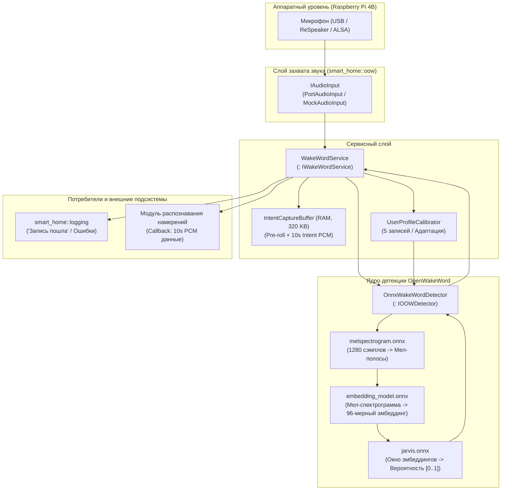
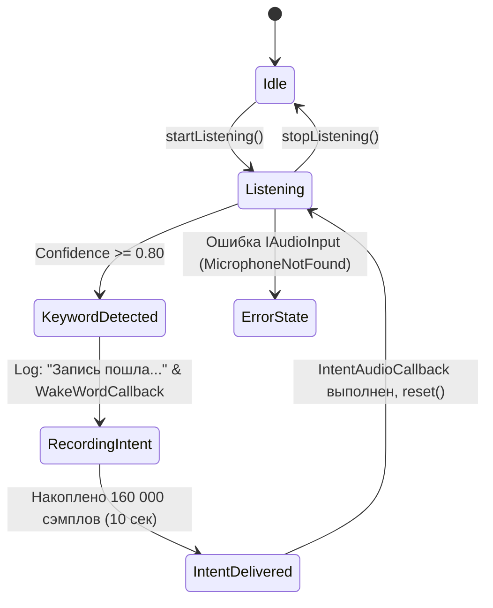
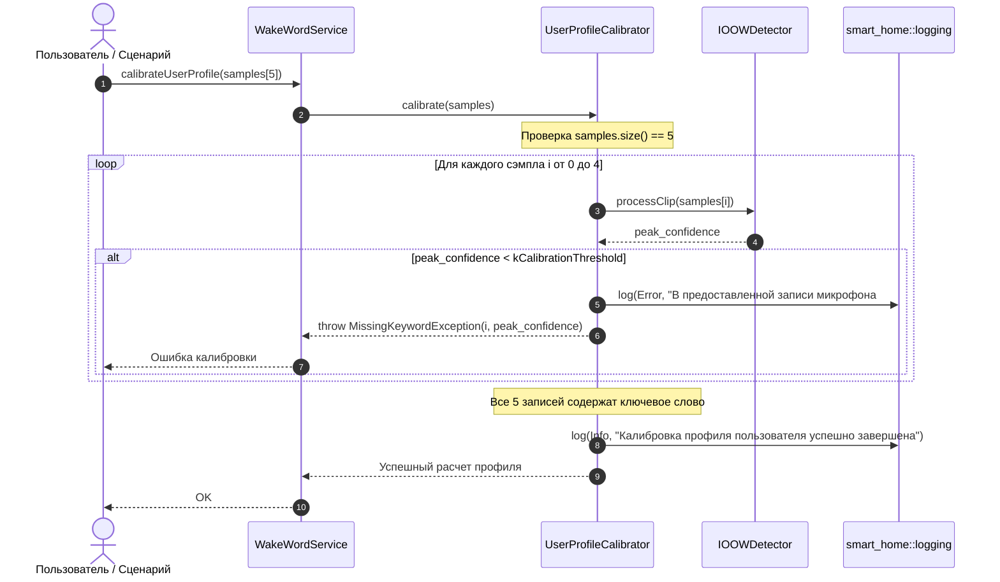

# Архитектурный дизайн спецификации модуля ключевого слова (OpenWakeWord)

Данный документ описывает детальную архитектуру, ключевые интерфейсы, гарантии потокобезопасности, модель владения и обработку ошибок для модуля детекции ключевого слова (`oow`), реализующего функционал спецификации [spec.md](spec.md) на платформе умного дома.

**Статус v1:** реализуется базовое ядро по [plan.md](plan.md). Описанные ниже
PortAudio/ONNX, профили на диске, индивидуальные пороги и обучение — целевая
архитектура v2. Точные контракты поставляемой v1 и отличия от этой целевой
архитектуры зафиксированы в разделе «Реализуемый объём v1» [spec.md](spec.md).
RAM-буфер v1 называется `IntentCaptureBuffer`, включает чанк активации и не
содержит дополнительного pre-roll. Калибровка v1 валидирует записи без
формирования/сохранения профиля и без изменения порога активации.

---

## 1. Контекст системы и аппаратные ограничения

Система развертывается на платформе **Raspberry Pi 4B (4x ARM Cortex-A72 @ 1.5–1.8 GHz, 8GB RAM, 120GB MicroSD)**.
Архитектурные решения модуля `oow` строго учитывают специфику платформы:

1. **Защита постоянного накопителя от износа (MicroSD wear-out prevention)**:
   - Аудиопоток непрерывно считывается с частотой 16 kHz (16-bit PCM mono = 32 КБ/сек).
   - Запись и буферизация 10-секундного фрагмента пользовательского намерения после обнаружения ключевого слова (требование `OWW-002`) производятся **исключительно в оперативной памяти (RAM)**.
   - Размер 10-секундного аудиофрагмента составляет:
     $$16\,000 \text{ сэмплов/сек} \times 2 \text{ байта} \times 10 \text{ сек} = 320\,000 \text{ байт} \approx 312.5 \text{ КБ}$$
     Хранение такого объема в RAM тривиально при 8 ГБ доступной памяти и полностью исключает циклическую перезапись ячеек Flash-памяти MicroSD.
   - Постоянное хранилище (MicroSD) используется только для чтения предобученных ONNX-моделей при инициализации и атомарного сохранения проверенных калибровочных сэмплов пользователя при первичной настройке.
2. **Бюджет процессорного времени (CPU budget & thread isolation)**:
   - Модель инференса ONNX Runtime конфигурируется с жестким ограничением потоков:
     `intra_op_num_threads = 1`, `inter_op_num_threads = 1`.
   - Это гарантирует, что непрерывный поиск ключевого слова не загрузит более одного вычислительного ядра Cortex-A72 и не вызовет голодания (starvation) критических сервисов умного дома (диспетчер команд, база онтологии LadybugDB, сетевой стек MQTT).
   - Скользящее окно инференса выполняется дискретными порциями (чанками) по 80 мс (1280 сэмплов @ 16 kHz), что обеспечивает минимальную задержку реакции ($\le 100$ мс) при средней загрузке ядра не более 10–15%.

---

## 2. Анализ требований, расхождения и допущения

### 2.1. Расхождения в спецификации (Discrepancy Analysis)
В соответствии с требованиями `AGENTS.md` явно фиксируются расхождения:
- **Префиксы идентификаторов требований**: В [spec.md](spec.md) требования `OWW-001` и `OWW-002` используют префикс `OWW` (сокращение от *OpenWakeWord*), в то время как `OOW-003`, `OOW-004` и `OOW-005` используют префикс `OOW`. Имя директории в `specs/` и таблице `specs/README.md` зафиксировано как `oow`.
- **Решение**: Модуль, библиотека CMake и пространство имен C++ стандартизируются под имя `oow` (`smart_home::oow`, таргет `SmartHome::OOW`), компонент логирования — `"OOW"`. При этом в кодовой базе и тестах сохраняется сквозная трассировка всех пяти требований (`OWW-001`, `OWW-002`, `OOW-003`, `OOW-004`, `OOW-005`).

### 2.2. Трассировка требований к архитектуре

| Идентификатор | Формулировка спецификации | Архитектурное решение |
|---|---|---|
| **OWW-001** | Прием 5 записей с микрофона для подгонки модели под пользователя | Метод `WakeWordService::calibrateUserProfile(const std::vector<AudioClip>&)`. Принимает ровно 5 аудиозаписей, производит проверку ключевого слова и формирует акустический профиль пользователя. |
| **OWW-002** | После 80% уверенности вывод в логи, что запись пошла, и запись 10 секунд звука с микрофона | При достижении уверенности $P \ge 0.80$ потоковый сервис пишет в лог сообщение: `"Запись пошла: обнаружено ключевое слово 'Джарвис' (уверенность: ...)"` (`Level::Info`, компонент `"OOW"`), вызывает `WakeWordCallback`, переходит в состояние `RecordingIntent` и захватывает 10 секунд PCM-данных в RAM-буфер с последующей передачей в `IntentAudioCallback`. |
| **OOW-003** | Корректная ошибка в логи о том, что микрофон не найден или не настроен | Класс `IAudioInput` (реализация `PortAudioInput`) при отсутствии или ошибке открытия аудиоустройства генерирует исключение `MicrophoneNotFoundException` и записывает сообщение `"Микрофон не найден или не настроен: <детали>"` уровня `Level::Error` через `smart_home::logging`. |
| **OOW-004** | Корректная ошибка в логи, что в предоставленной записи микрофона нет ключевого слова | `UserProfileCalibrator` проверяет каждую из 5 калибровочных записей через `IOOWDetector::processClip()`. Если хотя бы в одной записи $P_{max} < kCalibrationThreshold$, в лог пишется ошибка уровня `Level::Error` (`"В предоставленной записи микрофона #<index> нет ключевого слова"`), и выбрасывается `MissingKeywordException(sample_index, confidence)`. |
| **OOW-005** | Реакция на ключевое слово «Джарвис» | Модуль инференса OpenWakeWord C++ загружает классификатор `jarvis.onnx` (в связке с `melspectrogram.onnx` и `embedding_model.onnx`). Для платформенно-независимого тестирования интерфейс детектора `IOOWDetector` отделен от ONNX Runtime. |

### 2.3. Зафиксированные допущения (Assumptions)
1. **Разделение онлайн-адаптации и оффлайн-дообучения**:
   - В соответствии с разделом «Границы» спецификации, дообучение нейросетевых весов модели выполняется внешними инструментами (Google Colab / PiperTTS notebook).
   - Встроенный метод адаптации `calibrateUserProfile` решает задачу валидации качества 5 эталонных фраз пользователя, расчета индивидуального порога срабатывания и сохранения валидированных образцов в профиль пользователя (`/data/profiles/<user>/`) для последующего пакетного дообучения.
2. **Формат аудиопотока**:
   - Стандартный формат OpenWakeWord: 16 000 Гц (16 kHz), 16-бит знаковый PCM (`int16_t`), 1 канал (моно).
3. **Размер чанка инференса**:
   - Чанк составляет 1280 сэмплов (80 миллисекунд), что соответствует размеру шага входного фрейма мел-спектрограммы OpenWakeWord.

---

## 3. Компонентная структура и поток данных

### 3.1. Архитектурная диаграмма



---

## 4. Спецификация ключевых интерфейсов

### 4.1. Типы аудиоданных (`AudioTypes.h`)

```cpp
namespace smart_home::oow {

constexpr uint32_t kDefaultSampleRateHz = 16000;
constexpr uint32_t kDefaultBytesPerSample = 2; // 16-bit PCM mono
constexpr size_t kChunkSizeSamples = 1280;     // 80 мс скользящее окно
constexpr float kActivationThreshold = 0.80f;  // 80% порог уверенности (OWW-002)
constexpr float kCalibrationThreshold = 0.65f; // Минимальная уверенность для калибровки (OOW-004)
constexpr size_t kRequiredCalibrationClips = 5; // Требование OWW-001
constexpr size_t kIntentAudioDurationSec = 10;  // Требование OWW-002
constexpr size_t kIntentAudioSamplesCount = kDefaultSampleRateHz * kIntentAudioDurationSec; // 160 000 сэмплов

struct AudioFormat {
    uint32_t sample_rate = kDefaultSampleRateHz;
    uint16_t channels = 1;
    uint16_t bits_per_sample = 16;
};

struct AudioClip {
    std::vector<int16_t> samples;
    AudioFormat format;
};

struct DetectionResult {
    bool detected{false};
    float confidence{0.0f};
    std::string keyword;
};

} // namespace smart_home::oow
```

### 4.2. Абстракция захвата звука (`interfaces/IAudioInput.h`)

Интерфейс изолирует аппаратный аудиоввод (ALSA / PortAudio), что позволяет проводить полное автоматическое тестирование без физического аудиооборудования.

```cpp
namespace smart_home::oow {

/**
 * @brief Абстрактный интерфейс источника звука.
 * @details Реализация не должна захватывать ресурсы MicroSD. Потокобезопасность:
 *          методы readChunk вызываются из отдельного потока захвата.
 */
class IAudioInput {
public:
    virtual ~IAudioInput() = default;

    /**
     * @brief Инициализирует и открывает аудиоустройство.
     * @param format Требуемый формат дискретизации (номинально 16 kHz 16-bit mono).
     * @throws MicrophoneNotFoundException Если аудиоустройство недоступно или не настроено.
     */
    virtual void open(const AudioFormat& format) = 0;

    /** @brief Запускает захват аудиопотока. */
    virtual void start() = 0;

    /** @brief Останавливает захват аудиопотока. */
    virtual void stop() = 0;

    /**
     * @brief Считывает порцию аудиосэмплов (блокирующий вызов с таймаутом).
     * @param[out] out_chunk Буфер для размещения считанных сэмплов.
     * @param chunk_size Количество сэмплов для считывания (1280).
     * @return true, если чанк считан успешно; false при завершении потока или ошибке.
     */
    virtual bool readChunk(std::vector<int16_t>& out_chunk, size_t chunk_size) = 0;

    /** @brief Проверяет доступность и готовность аудиоустройства к работе. */
    virtual bool isAvailable() const noexcept = 0;
};

} // namespace smart_home::oow
```

### 4.3. Интерфейс детектора OpenWakeWord (`interfaces/IOOWDetector.h`)

```cpp
namespace smart_home::oow {

/**
 * @brief Интерфейс инференса ключевого слова OpenWakeWord.
 * @details Инкапсулирует вычисления ONNX Runtime либо mock-реализацию для юнит-тестов.
 */
class IOOWDetector {
public:
    virtual ~IOOWDetector() = default;

    /**
     * @brief Потоковая передача аудиочанка для скользящего инференса.
     * @param samples Указатель на 16-bit моно сэмплы (16 kHz).
     * @param count Количество сэмплов (1280 сэмплов).
     * @return Результат оценки вероятности ключевого слова («Джарвис»).
     */
    virtual DetectionResult feed(const int16_t* samples, size_t count) = 0;

    /**
     * @brief Пакетная валидация аудиозаписи целиком (для калибровки профиля).
     * @param clip Аудиозапись с ключевым словом.
     * @return Максимальная зафиксированная вероятность ключевого слова.
     */
    virtual float processClip(const AudioClip& clip) = 0;

    /** @brief Сброс внутреннего скользящего контекста и буферов мел-спектрограммы. */
    virtual void reset() = 0;
};

} // namespace smart_home::oow
```

### 4.4. Сервис управления и событийная модель (`interfaces/IWakeWordService.h`)

```cpp
namespace smart_home::oow {

using WakeWordCallback = std::function<void(float confidence)>;
using IntentAudioCallback = std::function<void(const std::vector<int16_t>& audio_10s)>;

/**
 * @brief Главный фасад подсистемы детекции ключевого слова.
 * @details Управляет жизненным циклом фонового потока, реакцией на активацию и буферизацией намерения.
 */
class IWakeWordService {
public:
    virtual ~IWakeWordService() = default;

    /**
     * @brief Запуск фонового непрерывного прослушивания микрофона.
     * @throws MicrophoneNotFoundException При отсутствии или сбое аудиовхода (OOW-003).
     */
    virtual void startListening() = 0;

    /** @brief Остановка прослушивания и синхронное завершение фонового потока. */
    virtual void stopListening() = 0;

    /**
     * @brief Подгонка модели под пользователя по 5 записям (OWW-001, OOW-004).
     * @param samples Ровно 5 аудиозаписей с ключевым словом «Джарвис».
     * @throws MissingKeywordException Если хотя бы в одной записи ключевое слово отсутствует.
     * @throws std::invalid_argument Если передано не ровно 5 записей.
     */
    virtual void calibrateUserProfile(const std::vector<AudioClip>& samples) = 0;

    /** @brief Регистрация callback-а на срабатывание ключевого слова. */
    virtual void setWakeWordCallback(WakeWordCallback cb) = 0;

    /** @brief Регистрация callback-а на готовность 10-секундной записи намерения. */
    virtual void setIntentAudioCallback(IntentAudioCallback cb) = 0;

    /** @brief Проверка активного состояния сервиса. */
    virtual bool isListening() const noexcept = 0;
};

} // namespace smart_home::oow
```

---

## 5. Детальные механизмы работы

### 5.1. Потоковое обнаружение и захват 10 секунд звука (OWW-002, OOW-005)

1. Фоновый рабочий поток непрерывно вызывает `IAudioInput::readChunk()`, получая порции по 1280 сэмплов (80 мс).
2. Чанк передается в `IOOWDetector::feed()`. Детектор возвращает текущую оценку уверенности $P \in [0.0, 1.0]$ для ключевого слова «Джарвис».
3. При фиксации порога активации ($P \ge 0.80$):
   - Записывается диагностический лог уровня `Level::Info` через `smart_home::logging`:
     `"Запись пошла: обнаружено ключевое слово 'Джарвис' (уверенность: 0.8X)"`
   - Локально копируется и асинхронно/вне мьютекса вызывается зарегистрированный `WakeWordCallback(confidence)`.
   - Внутреннее состояние переключается в `RecordingIntent`.
   - Начинается накопление сэмплов в буфер оперативной памяти `IntentCaptureBuffer` до достижения объема 160 000 сэмплов (ровно 10 секунд аудио @ 16 kHz).
   - По завершении 10-секундного интервала буфер передается в `IntentAudioCallback`, состояние переключается обратно в `Listening`, а внутренний контекст детектора сбрасывается (`detector->reset()`), предотвращая повторное ложное срабатывание на остаточный хвост фразы.



### 5.2. Калибровка модели по 5 записям (OWW-001, OOW-004)



1. **Проверка размера**: метод принимает строго вектор из 5 записей. Если `samples.size() != 5`, немедленно выбрасывается `std::invalid_argument`.
2. **Пофайловая верификация**:
   - Для каждой записи $i \in \{0, 1, 2, 3, 4\}$ вызывается `detector->processClip(samples[i])`.
   - Если максимальная уверенность ниже порога калибровки ($P_{max} < 0.65$):
     - В лог записывается сообщение об ошибке уровня `Level::Error`:
       `"В предоставленной записи микрофона #" + std::to_string(i) + " нет ключевого слова (уверенность: " + ... + ")"`
     - Выбрасывается исключение `MissingKeywordException(i, peak_confidence)`.
     - Процесс прерывается, профиль не загрязняется некорректными сэмплами.
3. **Формирование профиля**:
   - При успешном прохождении всех 5 сэмплов рассчитываются средняя акустическая энергия и базовая уверенность пользователя.
   - Сэмплы сохраняются для оффлайн-дообучения.
   - В лог пишется `Level::Info`: `"Калибровка профиля пользователя успешно завершена по 5 записям"`.

---

## 6. Обработка ошибок и логирование

Используется иерархия исключений, принятая в проекте (`common`, `storage`, `mqtt`):

```cpp
namespace smart_home::oow {

/** @brief Базовое исключение подсистемы OpenWakeWord. */
class OOWException : public std::runtime_error {
public:
    explicit OOWException(const std::string& msg) : std::runtime_error(msg) {}
};

/** @brief Микрофон не найден, занят другим процессом или некорректно сконфигурирован. */
class MicrophoneNotFoundException : public OOWException {
public:
    explicit MicrophoneNotFoundException(const std::string& msg)
        : OOWException("Микрофон не найден или не настроен: " + msg) {}
};

/** @brief В одной из переданных для калибровки записей отсутствует ключевое слово. */
class MissingKeywordException : public OOWException {
public:
    MissingKeywordException(size_t sample_index, float confidence)
        : OOWException("В предоставленной записи микрофона #" + std::to_string(sample_index) +
                       " нет ключевого слова (уверенность: " + std::to_string(confidence) + ")"),
          sample_index_(sample_index), confidence_(confidence) {}

    size_t sampleIndex() const noexcept { return sample_index_; }
    float confidence() const noexcept { return confidence_; }

private:
    size_t sample_index_;
    float confidence_;
};

/** @brief Ошибка загрузки или инициализации ONNX-модели. */
class ModelLoadException : public OOWException {
public:
    explicit ModelLoadException(const std::string& model_path)
        : OOWException("Не удалось загрузить ONNX-модель: " + model_path) {}
};

} // namespace smart_home::oow
```

### 6.1. Стандарты логирования (`smart_home::logging`)
Все события протоколируются без утечки конфиденциальной голосовой информации (только служебные метаданные и метрики уверенности):
- **Компонент**: `"OOW"`
- **Ошибка микрофона (`OOW-003`)**:
  `smart_home::logging::log(Level::Error, "OOW", "Микрофон не найден или не настроен: <детали ошибки>");`
- **Активация и старт записи (`OWW-002`)**:
  `smart_home::logging::log(Level::Info, "OOW", "Запись пошла: обнаружено ключевое слово 'Джарвис' (уверенность: 0.85)");`
- **Отсутствие ключевого слова в сэмпле (`OOW-004`)**:
  `smart_home::logging::log(Level::Error, "OOW", "В предоставленной записи микрофона #<index> нет ключевого слова");`

---

## 7. Владение, время жизни и гарантии многопоточности

1. **Владение ресурсами (Ownership)**:
   - `WakeWordService` монопольно владеет экземплярами `std::unique_ptr<IAudioInput>` и `std::unique_ptr<IOOWDetector>`.
   - Внедрение зависимостей (Dependency Injection) через конструктор позволяет передавать тестовые Mock-реализации без модификации логики сервиса.
2. **Время жизни (Lifetime & RAII)**:
   - При вызове `stopListening()` или уничтожении объекта `~WakeWordService()` выставляется флаг завершения `stop_requested_ = true`, прерывается блокирующее чтение аудиовхода, и фоновый поток корректно синхронизируется через `thread.join()`.
   - Деструктор помечен как `noexcept` и никогда не выбрасывает исключений.
3. **Потокобезопасность (Thread Safety & Deadlock Prevention)**:
   - Аудиопоток непрерывно обрабатывается в выделенном рабочем потоке `capture_thread_`.
   - Защита разделяемого состояния (текущий режим, колбэки, пороги) обеспечивается через `std::mutex state_mutex_`.
   - **Важно**: Вызовы пользовательских callbacks (`WakeWordCallback`, `IntentAudioCallback`) выполняются **строго со снятым мьютексом**, что полностью исключает риск взаимных блокировок (inversion of control / deadlocks), если внешний обработчик решит вызвать методы `WakeWordService`.
   - Операция калибровки `calibrateUserProfile()` выполняется синхронно в потоке вызывающей стороны. В v1 общий мьютекс детектора приостанавливает инференс, возможен один уже прочитанный чанк; сам источник не останавливается. Callbacks вызываются без этого мьютекса.

---

## 8. Архитектура интеграции с CMake и ONNX Runtime

1. Модуль оформляется как статическая библиотека `smart_home_oow` с псевдонимом `SmartHome::OOW`.
2. Зависимости:
   - `SmartHome::Common` (публичная)
   - `SmartHome::Logging` (публичная/приватная)
   - `Threads::Threads` (приватная)
   - `PortAudio` / `libonnxruntime` (при наличии на хосте; при отсутствии модуль компилирует базовое ядро и моки).
3. Директория моделей: `oow/models/`:
   - `melspectrogram.onnx`
   - `embedding_model.onnx`
   - `jarvis.onnx`
4. Структура директорий модуля:
   ```
   oow/
   ├── CMakeLists.txt
   ├── include/
   │   └── oow/
   │       ├── AudioTypes.h
   │       ├── OOWErrors.h
   │       ├── RingBuffer.h
   │       ├── UserProfileCalibrator.h
   │       ├── WakeWordService.h
   │       ├── PortAudioInput.h
   │       ├── OnnxWakeWordDetector.h
   │       └── interfaces/
   │           ├── IAudioInput.h
   │           ├── IOOWDetector.h
   │           └── IWakeWordService.h
   ├── src/
   │   ├── UserProfileCalibrator.cpp
   │   ├── WakeWordService.cpp
   │   ├── PortAudioInput.cpp
   │   └── OnnxWakeWordDetector.cpp
   └── models/
   ```

---

## 9. План верификации и тестирования

1. **Модульные тесты без физического оборудования (`tests/OOWMockTests.cpp`)**:
   - `MicrophoneNotFoundTest` (`OOW-003`): `MockAudioInput` имитирует сбой открытия устройства -> проверка лога `Level::Error` и выброса `MicrophoneNotFoundException`.
   - `MissingKeywordTest` (`OOW-004`): подача 5 записей, где запись #2 не содержит ключевого слова ($P < 0.65$) -> проверка лога `Level::Error` и исключения `MissingKeywordException` с `sampleIndex() == 2`.
   - `ValidCalibrationTest` (`OWW-001`): подача 5 валидных записей ($P \ge 0.65$) -> проверка успешного завершения калибровки и лога `Level::Info`.
   - `ActivationThresholdTest` (`OWW-002`): подача чанка с уверенностью 0.85 -> проверка лога `"Запись пошла"`, вызова `WakeWordCallback`, накопления 10 секунд (160 000 сэмплов) в RAM и вызова `IntentAudioCallback`.
   - `IntentBufferRamOnlyTest`: проверка того, что 10-секундный захват не обращается к файловой системе и сохраняет целостность аудиоданных.
2. **Интеграционные тесты с моделями ONNX (`tests/OOWIntegrationTests.cpp`)**:
   - Загрузка `melspectrogram.onnx`, `embedding_model.onnx`, `jarvis.onnx`.
   - Подача синтезированного WAV-файла со словом «Джарвис» -> проверка фиксации детекции с уверенностью $\ge 0.80$ (`OOW-005`).
