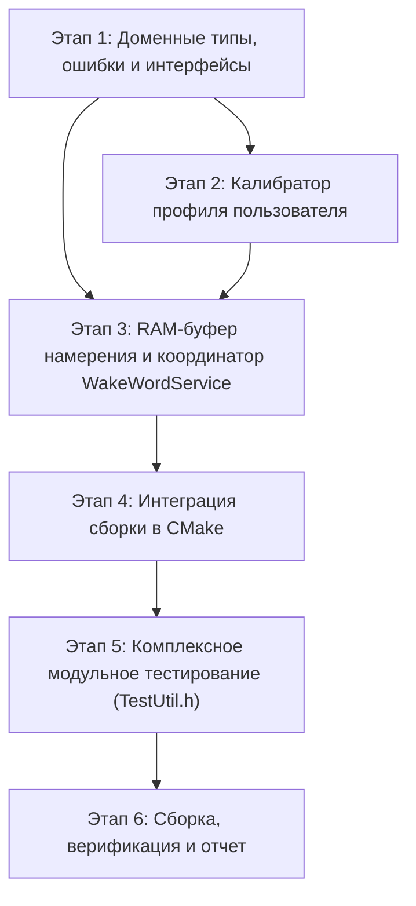

# План поэтапной реализации модуля ключевого слова (OpenWakeWord, v1)

Данный документ содержит пошаговый план реализации первой версии (v1) модуля детекции ключевого слова (`oow`) в соответствии со спецификацией [spec.md](spec.md) и архитектурным проектом [design.md](design.md).

---

## 1. Концепция первой версии и правила для AI-агентов

### 1.1. Стратегия v1 (Scope & Boundaries)
- **Фокус v1**: Полная реализация доменной логики сервиса, потокобезопасного буферизатора намерения в RAM, механизма калибровки профиля пользователя, обработки ошибок и контрактного тестирования на базе Mock-компонентов без жесткой привязки к физическому оборудованию и тяжеловесным бинарным зависимостям ONNX Runtime на этапе сборки юнит-тестов.
- **Подготовка к v2**: Интерфейсы проектируются с учетом последующего бесшовного подключения `PortAudioInput` (захват с реального USB/I2S микрофона) и `OnnxWakeWordDetector` (реальный инференс нейросети `jarvis.onnx`).

### 1.2. Критические инструкции для AI-агента (Strict Guidelines)
> [!IMPORTANT]
> 1. **Тестовый фреймворк**: В проекте **НЕ используются** внешние фреймворки `GTest` или `Catch2`. Модульные тесты пишутся на базе проектного заголовка [tests/TestUtil.h](../../tests/TestUtil.h) с функциями `require(condition, msg)` и `expectException<ExceptionType>(lambda)`, а точка входа оформляется как `int main()`. Не добавляй `find_package(GTest)` в CMake!
> 2. **Готовые интерфейсы 1-в-1**: Сигнатуры, структуры и классы исключений брать строго из раздела 4 и раздела 6 документа [design.md](design.md). Не видоизменяй названия типов и методов.
> 3. **Логирование**: Использовать проектную подсистему [logging/include/logging/Logging.h](../../logging/include/logging/Logging.h):
>    - `smart_home::logging::log(Level::Info, "OOW", "Запись пошла: обнаружено ключевое слово 'Джарвис' (уверенность: ...)")`
>    - `smart_home::logging::log(Level::Error, "OOW", "Микрофон не найден или не настроен: ...")`
>    - `smart_home::logging::log(Level::Error, "OOW", "В предоставленной записи микрофона #<index> нет ключевого слова")`
> 4. **Защита MicroSD от износа (Raspberry Pi 4B)**:
>    - Запрещено выполнять запись непрерывного аудио и 10-секундного буфера на диск. Все операции потокового накопления выполняются строго в оперативной памяти (RAM).
> 5. **Потокобезопасность**:
>    - Пользовательские колбэки (`WakeWordCallback`, `IntentAudioCallback`) вызывать **строго со снятым мьютексом**, чтобы исключить deadlock при обратных вызовах сервиса.

### 1.3. Трассировка требований спецификации
- **OWW-001**: Прием ровно 5 аудиозаписей для калибровки профиля.
- **OWW-002**: Логирование `"Запись пошла..."` при уверенности $\ge 80\%$, вызов callback и захват 10 секунд звука (160 000 сэмплов) в RAM без записи на MicroSD.
- **OOW-003**: Логирование ошибки и выброс `MicrophoneNotFoundException` при сбое микрофона.
- **OOW-004**: Логирование ошибки и выброс `MissingKeywordException` при отсутствии ключевого слова ($P < 0.65$) в любой из 5 записей.
- **OOW-005**: Поддержка контракта детекции ключевого слова «Джарвис» через абстракцию `IOOWDetector`.

---

## 2. Пошаговый план разработки



---

### Этап 1: Доменные типы, интерфейсы и иерархия ошибок

**Цель**: Создать типизированный фундамент модуля и интерфейсные контракты строго по коду из `design.md`.

- [x] **Шаг 1.1**: Создать заголовочный файл `oow/include/oow/AudioTypes.h` (см. `design.md`, раздел 4.1):
  - Константы: `kDefaultSampleRateHz = 16000`, `kDefaultBytesPerSample = 2`, `kChunkSizeSamples = 1280`, `kActivationThreshold = 0.80f`, `kCalibrationThreshold = 0.65f`, `kRequiredCalibrationClips = 5`, `kIntentAudioDurationSec = 10`, `kIntentAudioSamplesCount = 160000`.
  - Структуры: `AudioFormat`, `AudioClip`, `DetectionResult`.
- [x] **Шаг 1.2**: Создать заголовочный файл `oow/include/oow/OOWErrors.h` (см. `design.md`, раздел 6):
  - Иерархия исключений: `OOWException` (наследник `std::runtime_error`), `MicrophoneNotFoundException`, `MissingKeywordException` (с методами `sampleIndex()` и `confidence()`), `ModelLoadException`.
- [x] **Шаг 1.3**: Описать интерфейсы в `oow/include/oow/interfaces/`:
  - `IAudioInput.h` (см. `design.md`, раздел 4.2): методы `open(const AudioFormat&)`, `start()`, `stop()`, `readChunk(std::vector<int16_t>&, size_t)`, `isAvailable()`.
  - `IOOWDetector.h` (см. `design.md`, раздел 4.3): методы `feed(const int16_t*, size_t)`, `processClip(const AudioClip&)`, `reset()`.
  - `IWakeWordService.h` (см. `design.md`, раздел 4.4): типы `WakeWordCallback`, `IntentAudioCallback`, методы `startListening()`, `stopListening()`, `calibrateUserProfile(const std::vector<AudioClip>&)`, `setWakeWordCallback(WakeWordCallback)`, `setIntentAudioCallback(IntentAudioCallback)`, `isListening()`.

**Критерии завершения**:
- Заголовочные файлы полностью соответствуют сигнатурам из `design.md` и компилируются независимо.

---

### Этап 2: Калибратор профиля пользователя (`UserProfileCalibrator`)

**Цель**: Реализовать проверку и калибровку 5 эталонных записей ключевого слова.

- [x] **Шаг 2.1**: Создать заголовочный файл `oow/include/oow/UserProfileCalibrator.h`:
  - Определение класса `UserProfileCalibrator`.
  - Метод `void calibrate(const std::vector<AudioClip>& samples)`.
  - Зависимость от `IOOWDetector&` для проверки качества записей.
- [x] **Шаг 2.2**: Реализовать логику в `oow/src/UserProfileCalibrator.cpp`:
  - Проверка входного вектора: если `samples.size() != 5`, выброс `std::invalid_argument("Expected exactly 5 audio clips for calibration")`.
  - Итерация по 5 сэмплам: вызов `detector_.processClip(samples[i])`.
  - Если для сэмпла с индексом $i$ пиковая уверенность $P_{max} < kCalibrationThreshold$ (0.65f):
    - Логирование через `smart_home::logging::log(Level::Error, "OOW", "В предоставленной записи микрофона #" + std::to_string(i) + " нет ключевого слова")`.
    - Выброс `MissingKeywordException(i, peak_confidence)`.
  - Если все 5 сэмплов валидны:
    - Логирование `Level::Info`: `"Калибровка профиля пользователя успешно завершена по 5 записям"`.

**Критерии завершения**:
- Логика изолирована, детерминирована и полностью закрывает требования `OWW-001` и `OOW-004`.

---

### Этап 3: RAM-буферизация и координатор `WakeWordService`

**Цель**: Реализовать потокобезопасный сервис прослушивания и фиксации 10-секундного намерения в оперативной памяти (без записи на MicroSD).

- [x] **Шаг 3.1**: Реализовать буфер в оперативной памяти `oow/include/oow/IntentCaptureBuffer.h`:
  - Емкость строго 160 000 сэмплов (`int16_t`, 320 КБ в RAM).
  - Методы: `pushChunk(const int16_t* data, size_t count)`, `bool isComplete() const`, `const std::vector<int16_t>& data() const`, `void reset()`.
- [x] **Шаг 3.2**: Создать заголовочный файл `oow/include/oow/WakeWordService.h`:
  - Наследование от `IWakeWordService`.
  - Конструктор: `WakeWordService(std::unique_ptr<IAudioInput> audio_input, std::unique_ptr<IOOWDetector> detector)`.
  - Состояния сервиса (`enum class State { Idle, Listening, RecordingIntent }`).
  - Поля многопоточности: `std::atomic<bool> is_running_{false}`, `std::thread worker_thread_`, `std::mutex mutex_`, `WakeWordCallback wake_cb_`, `IntentAudioCallback intent_cb_`.
- [x] **Шаг 3.3**: Реализовать логику сервиса в `oow/src/WakeWordService.cpp`:
  - `startListening()`:
    - Попытка открыть устройство: `audio_input_->open(format)`.
    - Если `!audio_input_->isAvailable()`:
      - Логирование: `smart_home::logging::log(Level::Error, "OOW", "Микрофон не найден или не настроен: устройство недоступно")`.
      - Выброс `MicrophoneNotFoundException("устройство недоступно")`.
    - `audio_input_->start()`.
    - Запуск фонового потока `worker_thread_`.
  - Фоновый цикл `workerLoop()`:
    - Чтение чанка: `audio_input_->readChunk(chunk, kChunkSizeSamples)`.
    - В состоянии `Listening`:
      - Вызов `auto res = detector_->feed(chunk.data(), chunk.size())`.
      - Если `res.confidence >= kActivationThreshold` (0.80f):
        - Логирование `Level::Info`: `"Запись пошла: обнаружено ключевое слово 'Джарвис' (уверенность: " + std::to_string(res.confidence) + ")"`.
        - Копирование колбэка `WakeWordCallback cb;` под блокировкой, вызов `cb(res.confidence)` **после снятия блокировки** (`OWW-002`).
        - Смена состояния на `RecordingIntent`, сброс `intent_buffer_`.
        - Добавление текущего чанка в `intent_buffer_`.
    - В состоянии `RecordingIntent`:
      - Добавление `chunk` в `intent_buffer_`.
      - При `intent_buffer_.isComplete()`:
        - Копирование колбэка `IntentAudioCallback cb;` и аудиоданных под блокировкой.
        - Вызов `cb(audio_data)` **со снятым мьютексом**.
        - Вызов `detector_->reset()`.
        - Возврат состояния в `Listening`.
  - `calibrateUserProfile(samples)`:
    - Делегирование в `UserProfileCalibrator`.
  - `stopListening()` и `~WakeWordService()`:
    - Выставление `is_running_ = false`, остановка `audio_input_->stop()`, синхронизация `worker_thread_.join()`. Деструктор помечен `noexcept`.

**Критерии завершения**:
- Отсутствие взаимных блокировок при любых действиях в callbacks.
- Исключена циклическая перезапись Flash-памяти MicroSD на RPi 4B.

---

### Этап 4: Интеграция сборки модуля в CMake

**Цель**: Встроить новый модуль в общую систему сборки CMake.

- [x] **Шаг 4.1**: Создать `oow/CMakeLists.txt`:
  ```cmake
  add_library(smart_home_oow STATIC
      src/UserProfileCalibrator.cpp
      src/WakeWordService.cpp
  )
  add_library(SmartHome::OOW ALIAS smart_home_oow)

  target_include_directories(smart_home_oow PUBLIC
      $<BUILD_INTERFACE:${CMAKE_CURRENT_SOURCE_DIR}/include>
      $<INSTALL_INTERFACE:include>
  )

  target_link_libraries(smart_home_oow PUBLIC
      SmartHome::Common
      SmartHome::Logging
      Threads::Threads
  )
  ```
- [x] **Шаг 4.2**: Зарегистрировать модуль в корневом [CMakeLists.txt](../../CMakeLists.txt):
  - Добавить `add_subdirectory(oow)` после `common` и `logging`.

**Критерии завершения**:
- Библиотека `SmartHome::OOW` успешно собирается `cmake --build build --target smart_home_oow`.

---

### Этап 5: Комплексное модульное тестирование на базе `TestUtil.h`

**Цель**: Покрыть все 5 требований спецификации тестами без использования внешних тестовых фреймворков.

- [x] **Шаг 5.1**: Создать тестовые заглушки в `tests/oow/`:
  - `MockAudioInput.h`: реализация `IAudioInput`. Позволяет симулировать отказ открытия устройства (`simulate_fail_open = true`), генерировать потоки сэмплов, останавливать поток по счетчику чанков.
  - `MockOOWDetector.h`: реализация `IOOWDetector`. Позволяет задавать массив уверенностей для последовательных вызовов `feed()`, возвращать заданную уверенность для `processClip()`, отслеживать вызовы `reset()`.
- [x] **Шаг 5.2**: Написать исполняемый файл тестов `tests/OOWTests.cpp`:
  - Использовать `#include "TestUtil.h"`:
    ```cpp
    #include "TestUtil.h"
    #include "oow/AudioTypes.h"
    #include "oow/OOWErrors.h"
    #include "oow/WakeWordService.h"
    #include "oow/UserProfileCalibrator.h"
    #include "oow/MockAudioInput.h"
    #include "oow/MockOOWDetector.h"
    ```
  - **Тест 1 (OOW-003)**: Проверка ошибки микрофона. `MockAudioInput` настроен на ошибку -> `expectException<smart_home::oow::MicrophoneNotFoundException>([&]{ service.startListening(); });`.
  - **Тест 2 (OWW-001, OOW-004)**: Проверка калибровки.
    - Передача 4 записей вместо 5 -> `expectException<std::invalid_argument>(...)`.
    - Передача 5 записей, где запись #2 имеет уверенность $0.40 < 0.65$ -> `expectException<smart_home::oow::MissingKeywordException>(...)` и проверка `e.sampleIndex() == 2`.
    - Передача 5 записей с уверенностью $\ge 0.65$ -> успешное завершение без исключений.
  - **Тест 3 (OWW-002, OOW-005)**: Проверка порога 80% и 10-секундного захвата.
    - `MockAudioInput` генерирует чанки по 1280 сэмплов.
    - `MockOOWDetector` выдает 0.85 на 2-м чанке.
    - Проверка срабатывания `WakeWordCallback`.
    - Проверка, что `IntentAudioCallback` вызывается ровно с 160 000 сэмплами.
    - Проверка, что после этого вызван `detector->reset()`.
  - **Тест 4**: Проверка безопасной остановки сервиса во время работы `stopListening()` без зависания потока.
  - Точка входа:
    ```cpp
    int main() {
        testMicrophoneNotFound();
        testCalibrationValidation();
        testKeywordDetectionAndIntentCapture();
        testConcurrentStop();
        return 0;
    }
    ```
- [x] **Шаг 5.3**: Зарегистрировать тестовый исполняемый файл в [tests/CMakeLists.txt](../../tests/CMakeLists.txt):
  ```cmake
  add_executable(oow_tests
      OOWTests.cpp
  )
  target_include_directories(oow_tests PRIVATE ${CMAKE_CURRENT_SOURCE_DIR})
  target_link_libraries(oow_tests PRIVATE
      SmartHome::OOW
      SmartHome::Logging
  )
  add_test(NAME oow_tests COMMAND oow_tests)
  ```

**Критерии завершения**:
- Тест компилируется без GTest, запускается и завершается с кодом 0.

---

### Этап 6: Сборка, верификация и итоговый отчёт

**Цель**: Выполнить валидацию сборки в соответствии с правилами `AGENTS.md`.

- [x] **Шаг 6.1**: Сборка проекта и тестового таргета:
  - `cmake --build build --target oow_tests -j`
- [x] **Шаг 6.2**: Запуск CTest:
  - `ctest --test-dir build -R oow_tests --output-on-failure`
- [x] **Шаг 6.3**: Запуск всех существующих тестов проекта для проверки отсутствия регрессий:
  - `ctest --test-dir build --output-on-failure`
- [x] **Шаг 6.4**: Формирование отчета с перечислением выполненных команд и статусов всех проверок.

---

## 3. План последующих доработок (Roadmap к v2)

После сдачи и стабилизации первой версии (v1) запланированы следующие этапы:

1. **Реализация `PortAudioInput` (Аппаратный захват)**:
   - Интеграция с библиотекой PortAudio / ALSA под архитектуру Raspberry Pi 4B (ARM64).
   - Поддержка USB-микрофонов и ReSpeaker HAT (выбор аудиоиндекса, обработка горячего отключения устройства).
2. **Реализация `OnnxWakeWordDetector` (Нейросетевое ядро)**:
   - Загрузка графов ONNX (`melspectrogram.onnx`, `embedding_model.onnx`, `jarvis.onnx`).
   - Настройка `Ort::SessionOptions` (`intra_op_num_threads = 1`) под Cortex-A72.
   - Подача синтезированных эталонных аудиофайлов со словом «Джарвис».
3. **Пакетная адаптация и сохранение калибровочных данных**:
   - Сохранение 5 валидированных WAV-файлов калибровки в пользовательский каталог `/data/profiles/<user>/`.
   - Интеграция со скриптом дообучения через Google Notebook / PiperTTS.
4. **Препроцессинг звука**:
   - Опциональный модуль шумоподавления и нормализации громкости (WebRTC AGC/NS) перед подачей в мел-спектрограмму.


## 4. Отчёт о реализации v1

Реализованы этапы 1–6: модуль `SmartHome::OOW`, публичные интерфейсы из
разделов 4 и 6 дизайна, проверка пяти записей, ограниченный RAM-буфер,
фоновый сервис, тестовые компоненты и регистрация в CMake/Doxygen.
Тесты используют `TestUtil.h` и существующий внутренний тестовый sink логгера.

Уточнения реализации:
- Буфер принадлежит рабочему потоку; callback получает ссылку на готовые
  данные без дополнительного копирования 320 КБ. Его время жизни ограничено
  вызовом callback. Мьютекс защищает регистрацию обработчиков; при выполнении
  обработчика не удерживается ни один мьютекс сервиса.
- Для повторных/конкурентных start/stop используется отдельная синхронизация
  жизненного цикла. Присоединение потока выполняется без мьютекса, чтобы
  `stopListening()` из callback не блокировал внешнюю остановку.
- `stop()` источника обязан разблокировать `readChunk()`; источник не
  логирует ошибки, это делает сервис. Калибровка сериализует обращения к
  детектору; физическая остановка микрофона не выполняется.
- Дополнительно проверяются непустой PCM-формат и диапазон уверенности.
  Точные контракты ошибок и границы v1 добавлены в [spec.md](spec.md).

Выполненные проверки:
- `cmake -S . -B build` — конфигурация успешна.
- `cmake --build build --target oow_tests -j 4` — модуль и тест собраны.
- `cmake --build build -j 4` — весь проект собран.
- `ctest --test-dir build -R '^oow_tests$' --output-on-failure` — успешно.
- `ctest --test-dir build -R '^oow_tests$' --repeat until-fail:30 --output-on-failure`
  — 30 успешных запусков, включая конкурентные start/stop и остановку из callback.
- `ctest --test-dir build --output-on-failure` — 18/18 тестов успешно.
- Все 8 публичных заголовков независимо проверены компилятором через
  `c++ -std=c++17 -Wall -Wextra -Wpedantic -Werror -fsyntax-only -x c++ -Ioow/include -`.
- `git diff --check` — ошибок пробелов нет.

Не выполнялись проверки с физическим микрофоном, моделями ONNX и на
Raspberry Pi: соответствующие адаптеры и аппаратная приёмка относятся к v2.
