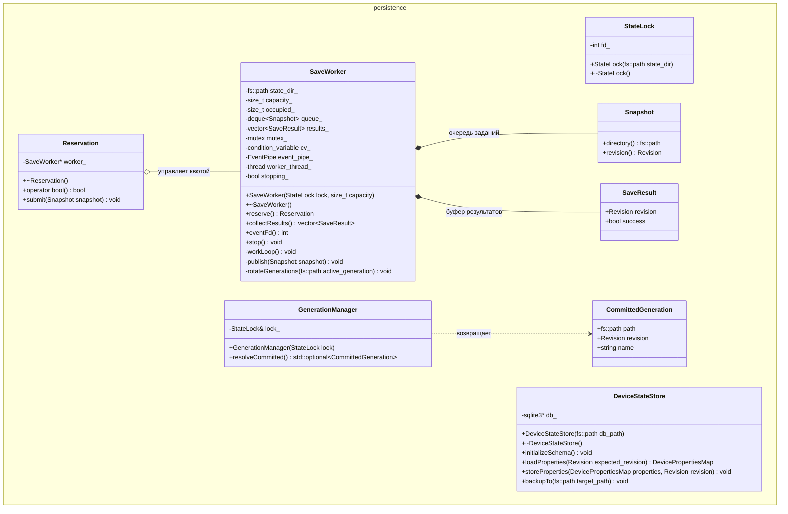
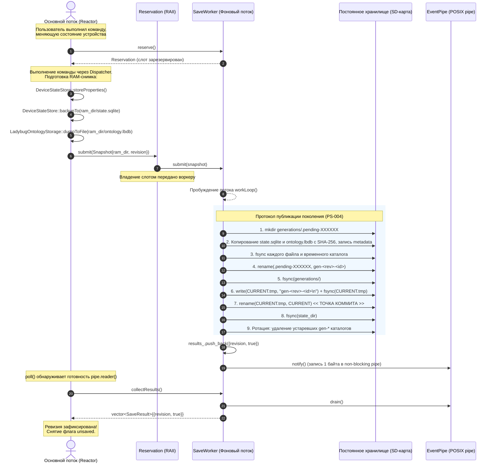

# Технические решения модуля persistence

Статус: реализовано в `persistence/` и подключено к реактору в `src/main.cpp`.
Основание: [spec.md](spec.md), `AGENTS.md`, тесты `tests/RuntimeTests.py`.
Целевая платформа — Linux, Raspberry Pi 4b 8/120 (SD-card), публичный API C++17, SQLite3, OpenSSL Crypto (EVP SHA-256).

---

## 1. Цели, границы и концепция поколений (Generation-Based Durability)

Модуль `SmartHome::Persistence` отвечает за согласованное, отказоустойчивое и долговечное хранение полного снимка умного дома на флеш-накопителе (SD-карте Raspberry Pi 4b).

### Проблема и концепция решения
1. **Медленный и изнашиваемый I/O SD-карты**: Частые случайные синхронные записи изнашивают карту памяти и приводят к непредсказуемым задержкам основного потока (до сотен миллисекунд).
2. **Внезапные отключения питания**: Обрыв питания в момент записи не должен приводить к повреждению базы данных или рассогласованию графа онтологии и инвентаря устройств.
3. **Изоляция поколений**: Состояние системы фиксируется квантами — нумерованными поколениями (`generations/gen-<revision>-<unique_suffix>`), состоящими из базы устройств `state.sqlite`, графа связей `ontology.lbdb` и манифеста целостности `metadata`.
4. **Атомарная точка коммита**: Переход на новую ревизию происходит строго в момент атомарной замены указателя `CURRENT` (`rename("CURRENT.tmp", "CURRENT")`). До этого момента активно предыдущее поколение; после него — новое.

### Границы ответственности
- **Входит в зону ответственности**:
  - Управление физическими файлами поколений и указателем `CURRENT` в постоянном каталоге `<state_dir>`.
  - Транзакционное сохранение и загрузка динамических свойств устройств в SQLite (`runtime_meta`, `device_properties`).
  - Создание изолированных RAM-снимков SQLite через SQLite Backup API (`sqlite3_backup`).
  - Фоновый асинхронный воркер `SaveWorker` с ограниченной очередью и семантикой предварительного резервирования `Reservation`.
  - Проверка криптографической целостности поколений (SHA-256 через OpenSSL EVP) при запуске и фиксации.
  - Межпроцессная блокировка состояния через `flock` (`runtime.lock`).
  - Точки внедрения отказов (`Testing.h`) для верификации сценариев аварийного отключения питания.
- **Не входит в зону ответственности**:
  - Хранение живых объектов устройств и диспетчеризация команд (ответственность `devices` и `execution`).
  - Генерация или валидация семантического графа (ответственность `ontology` и `device_management`).
  - Периодические таймеры сохранения (сохранение инициируется вызывающим кодом после изменяющих операций).

---

## 2. Архитектура модуля и разделение ответственности классов

Модуль организуется в пространстве имён `smart_home::persistence` и предоставляет четко разграниченные компоненты:

```text
persistence/
  CMakeLists.txt
  include/persistence/
    PersistenceConfig.h  # Проверка параметров и рабочего каталога RAM
    DeviceStateStore.h    # Управление свойствами устройств в SQLite и Backup API
    GenerationManager.h   # Валидация поколений, чтение CURRENT и манифестов SHA-256
    SaveWorker.h          # Фоновый поток сохранения, очередь Snapshot и протокол publish
    Reservation.h         # RAII-токен резервирования слота очереди
    StateLock.h           # Межпроцессная блокировка каталога (flock)
    PersistenceTypes.h    # Типы данных: Snapshot, SaveResult, Revision, PropertyValue
  src/
    DeviceStateStore.cpp
    GenerationManager.cpp
    SaveWorker.cpp
    Reservation.cpp
    StateLock.cpp
    FileUtils.h           # Приватные файловые утилиты (fsync, безопасное чтение/запись)
    FileUtils.cpp
    Testing.h             # Приватные точки внедрения отказов для тестов
```

### 2.1. `DeviceStateStore`
Отвечает за низкоуровневую работу с таблицами состояния в SQLite-базе `state.sqlite`.
- **Схема данных**:
  - `runtime_meta(version INTEGER NOT NULL, revision INTEGER NOT NULL)`: хранит версию схемы и монотонный номер ревизии.
  - `device_properties(device_id INTEGER NOT NULL, property_key TEXT NOT NULL, value_type TEXT NOT NULL, raw_value TEXT NOT NULL, updated_at INTEGER NOT NULL, PRIMARY KEY(device_id, property_key), FOREIGN KEY(device_id) REFERENCES devices(local_id) ON DELETE CASCADE)`: нормализованное хранилище значений параметров устройств с типизацией (`bool`, `int`, `double`, `color`, `string`).
- **Транзакционность**: Запись изменений выполняется внутри блока `BEGIN IMMEDIATE` ... `COMMIT` с автоматическим `ROLLBACK` при исключениях.
- **Интеграция с SQLite Backup API**: Метод `backupTo(const std::filesystem::path &target_path)` создает непротиворечивую копию открытой рабочей SQLite-базы в RAM без закрытия активных соединений и без блокировки читателей.
- **Проверка целостности**: Выполняет `PRAGMA integrity_check` при загрузке существующего состояния.

### 2.2. `GenerationManager`
Отвечает за версионирование и проверку целостности сохранённых комплектов.
- **Чтение указателя `CURRENT`**:
  - Проверяет формат указателя (строго `<generation_name>\n`, префикс `gen-`, отсутствие выходов за пределы каталога вроде `../`).
  - Определяет сценарий **первого чистого запуска** (файл `CURRENT` отсутствует -> возвращает пустое состояние `std::nullopt`).
- **Валидация манифеста `metadata`**:
  - Формат: заголовок `SMART_HOME_RUNTIME 1`, номер `Revision`, SHA-256 хеш `state.sqlite`, SHA-256 хеш `ontology.lbdb`.
  - Вычисляет фактические SHA-256 хеши обоих файлов поколения блоками по 64 КБ с использованием OpenSSL EVP API (`EVP_DigestInit_ex`, `EVP_DigestUpdate`, `EVP_DigestFinal_ex`).
  - Сверяет ревизию имени с манифестом и единственной строкой `runtime_meta`. Для чтения SQLite используется режим immutable без побочных файлов.
  - При несовпадении хешей или ревизии выбрасывает `std::runtime_error("Corrupt or mixed runtime generation")`.
- **Инвариант фатальности повреждений**: Повреждённое зафиксированное поколение **никогда** не сбрасывается автоматически в начальное состояние (защита от потери пользовательских настроек при сбое диска).

### 2.3. `SaveWorker` и `Reservation`
Отвечает за асинхронное выполнение тяжёлого дискового ввода-вывода и соблюдение backpressure.
- **Ограниченная очередь (`capacity`)**: Защищает Raspberry Pi 4b от исчерпания памяти при шторме команд. Количество одновременно обрабатываемых, ожидающих и зарезервированных снимков строго ограничено (по умолчанию 4).
- **Семантика `Reservation` (RAII)**:
  - Перед выполнением изменяющей состояние операции вызывающий код получает `Reservation` через `worker.reserve()`.
  - Если очередь заполнена, операция отклоняется **до** модификации оперативного состояния устройств.
  - Если операция завершилась ошибкой или не изменила состояние, деструктор `Reservation` автоматически возвращает слот в воркер.
  - При успехе метод `reservation.submit(std::move(snapshot))` передаёт владение снимком в очередь. Слот освобождается после получения результата через `collectResults()`.
- **Протокол публикации `publish`**: Пошаговый алгоритм атомарной фиксации на диск (см. раздел 4).
- **Неблокирующее оповещение**: По завершении фиксации воркер уведомляет основной поток через `EventPipe` (POSIX `pipe2` с `O_NONBLOCK` и `O_CLOEXEC`). Основной реактор обрабатывает `SaveResult` по готовности файлового дескриптора в `poll()`.
- **Ротация старых поколений**: После успешной замены `CURRENT` воркер удаляет предыдущие поколения, освобождая место на носителе. Ошибки удаления устаревших каталогов логируются, но не аннулируют успешный коммит.

### 2.4. `StateLock`
Обеспечивает межпроцессную взаимоисключающую блокировку каталога состояния:
- Создает файл `<state_dir>/runtime.lock`.
- Применяет неблокирующий эксклюзивный `flock(fd, LOCK_EX | LOCK_NB)`.
- При попытке параллельного запуска второго процесса немедленно завершает работу с понятной диагностикой.
  - `GenerationManager` и `SaveWorker` получают `StateLock` при создании. Дескриптор остаётся открытым до завершения работы обоих объектов.

---

## 3. Диаграммы архитектуры и взаимодействия

### 3.1. Архитектурная диаграмма классов (Mermaid)



### 3.2. Диаграмма последовательности фиксации поколения (Mermaid sequenceDiagram)



---

## 4. Протокол публикации и пошаговая отказоустойчивость

### 4.1. Восемь шагов публикации (`PS-004`)
Публикация поколения выполняется воркером в каталоге `<state_dir>`:
```text
<state_dir>/
  runtime.lock
  CURRENT
  CURRENT.tmp (временный)
  generations/
    .pending-a1b2c3/ (временный в процессе сборки)
    gen-1-xyz/ (предыдущее поколение)
    gen-2-abc/ (новое опубликованное поколение)
```

1. **Создание временного каталога**: Внутри `generations/` создаётся каталог `.pending-XXXXXX` (через `mkdtemp`). Использование той же файловой системы гарантирует атомарность последующего `rename`.
2. **Копирование файлов и `fsync`**:
   - `state.sqlite` копируется из RAM-снимка, вызывается `fsync(fd)`.
   - `ontology.lbdb` копируется из RAM-снимка, вызывается `fsync(fd)`.
   - SHA-256 обоих файлов вычисляется при копировании. Воркер записывает `metadata` и вызывает `fsync(fd)`.
   - Вызывается `fsync(dir_fd)` для каталога `.pending-XXXXXX`.
3. **Атомарное переименование каталога**: Вызов `rename(".pending-XXXXXX", "gen-<rev>-<unique_suffix>")`.
4. **Синхронизация родительского каталога**: Вызов `fsync(generations_dir_fd)`. Имя нового поколения надежно зафиксировано в таблице директории.
5. **Подготовка нового указателя**: Запись имени `gen-<rev>-<unique_suffix>\n` во временный файл `CURRENT.tmp` и вызов `fsync(current_tmp_fd)`.
6. **Фиксация поколения (Commit Point)**: Атомарный системный вызов `rename("CURRENT.tmp", "CURRENT")`.
7. **Финальный `fsync` каталога**: Вызов `fsync(state_dir_fd)`. Гарантирует, что обновление записи директории `CURRENT` сброшено из кэша ОС на физический накопитель.
8. **Оповещение**: Неблокирующая запись байта в `EventPipe`.

При обработанной ошибке до замены `CURRENT` воркер пытается удалить
подготовленный каталог и временный указатель. Это освобождает место для
повторной попытки после ошибки записи. После замены `CURRENT` прежний и
новый комплекты остаются доступны до успешного `fsync` каталога.

### 4.2. Анализ сбоев питания на каждом шаге (Power-Cut Matrix)

| Момент аварии (Power-Cut) | Состояние на диске при повторном старте | Поведение `GenerationManager` | Результат для системы |
|---|---|---|---|
| До шага 4 (во время записи `.pending-*`) | Каталог `.pending-*` частично записан; `CURRENT` указывает на старое поколение | Читает старое поколение из `CURRENT`, успешно валидирует манифест | **Полная целостность**: старое состояние сохранено, временный мусор игнорируется |
| После шага 4, до шага 6 (поколение готово, `CURRENT` не заменен) | Новое поколение `gen-N` целостно, но `CURRENT` указывает на `gen-(N-1)` | Читает `gen-(N-1)` по `CURRENT`, валидирует его | **Полная целостность**: система на ревизии N-1; незафиксированное поколение N будет удалено при следующей ротации |
| В момент шага 6 (`rename CURRENT.tmp -> CURRENT`) | Атомарная операция файловой системы POSIX: либо старый `CURRENT`, либо новый | Читает актуальный `CURRENT` | **Полная целостность**: система находится либо на ревизии N-1, либо на N. Промежуточное состояние невозможно |
| Шаг 7 (сбой до/во время `fsync(state_dir)`) | `CURRENT` указывает на новое поколение N, но метаданные директории могут быть в кэше | При старте проверяется целостность ревизии N. Если запись не дошла до флеш-памяти контроллера SD, читается N-1 | **Безопасность**: неопределённая долговечность трактуется как необходимость повторного коммита при штатной работе |
| Шаг 8 или во время ротации старых каталогов | Новое поколение зафиксировано, старые каталоги ещё не удалены | `CURRENT` указывает на N, ротация завершится при следующем коммите | **Полная целостность**: данные ревизии N активны |

---

## 5. Модель владения памятью (RAII) и потокобезопасность

### 5.1. Изоляция потоков
`SaveWorker` работает в отдельном потоке `std::thread`.
1. Основной поток формирует снимок в приватном подкаталоге `snapshot-XXXXXX` внутри рабочего каталога RAM.
2. `Snapshot` владеет каталогом и содержит ревизию. Перемещение в очередь передаёт владение воркеру. После попытки публикации временный снимок удаляется.
3. Воркер обрабатывает только файлы переданного снимка и каталога состояния. Отдельное SQLite-соединение воркера читает ревизию копии в RAM.

### 5.2. Семантика и жизненный цикл `Reservation`
```text
[Основной поток]
      |
      v
auto res = worker.reserve() -------- (!res) ----> [Изменение отклонено]
      | (успех)
      v
      +---> Выполнение команды/мутации
      |         |
      |         +---> Исключение / Сбой
      |                   |
      |                   v
      |            ~Reservation() -> worker.release() [Квота освобождена]
      v
res.submit(std::move(snapshot))
      |
      v
~Reservation() -> слот возвращается по collectResults()
```

### 5.3. Сохранение состояния в RAM при ошибках дискового I/O (PS-009)
Если на шаге подготовки снимка или записи на диск происходит сбой (например, переполнение SD-карты `ENOSPC`, ошибка I/O или сбой контроллера):
1. Исключение перехватывается воркером (`workLoop`). Воркер записывает результат `{revision, false}` в буфер `results_`.
2. В основном потоке реактора живые цифровые двойники устройств и рабочая SQLite-база в RAM **остаются в актуальном состоянии**.
3. Устанавливается флаг `unsaved_state = true`.
4. Основной поток логирует ошибку и выводит предупреждение пользователю. Повторная попытка сохранения будет выполнена при следующей команде, вызове `save` или при штатном завершении.

### 5.4. Штатное завершение работы (Graceful Shutdown)
При получении `SIGINT`, `SIGTERM`, EOF или команды `exit`:
1. Приложение прекращает прием новых пользовательских команд.
2. Приложение ждёт свободный слот и ставит финальный снимок в конец очереди.
3. Вызывается `SaveWorker::stop()`:
   - Выставляется флаг `stopping_ = true`.
   - Пробуждается условная переменная `cv_.notify_one()`.
   - Воркер дорабатывает все оставшиеся в очереди снимки.
   - Выполняется `thread_.join()`.
4. Приложение проверяет результат, освобождает ресурсы и снимает межпроцессный `StateLock`.

---

## 6. Детали реализации и SQLite схема

### 6.1. Схема `state.sqlite`
Воркер получает самостоятельную SQLite-копию без файлов журнала. `backupTo()`
использует SQLite Backup API, переводит копию в режим `DELETE` и закрывает
её до передачи. Сохранённые поколения v1 с `runtime_values` распознаются
при чтении. Первый вызов `storeProperties()` на рабочей копии переносит
данные в `device_properties` с обновлением `runtime_meta` в одной транзакции.

```sql
-- Таблица версии персистентного формата и номера ревизии
CREATE TABLE IF NOT EXISTS runtime_meta (
    version INTEGER NOT NULL,
    revision INTEGER NOT NULL
);

-- Таблица типизированных параметров устройств
CREATE TABLE IF NOT EXISTS device_properties (
    device_id INTEGER NOT NULL,
    property_key TEXT NOT NULL,
    value_type TEXT NOT NULL,
    raw_value TEXT NOT NULL,
    updated_at INTEGER NOT NULL,
    PRIMARY KEY (device_id, property_key),
    FOREIGN KEY (device_id) REFERENCES devices(local_id) ON DELETE CASCADE
);
```

### 6.2. Сериализация и типизация `device_properties`
Поле `value_type` поддерживает стандартные типы значений умного дома:
- `bool`: `raw_value` = `"true"` | `"false"`
- `int`: `raw_value` = строковое представление 64-битного целого (например `"75"`)
- `double`: `raw_value` = строковое представление с плавающей точкой (например `"23.5"`)
- `color`: `raw_value` = `"R,G,B"` (например `"255,128,0"`)
- `string`: произвольная текстовая строка

В одной транзакции удаляются прежние свойства и записывается полный новый набор.
Значения передаются параметрами подготовленного запроса.
```sql
INSERT INTO device_properties (device_id, property_key, value_type, raw_value, updated_at)
VALUES (?, ?, ?, ?, ?);
```

---

## 7. Тестовые точки отказов (`Testing.h`)

Для детерминированных сценариев задержек и аварийного завершения процесса
используются тестовые точки. Они активны при компиляции с макросом
`SMART_HOME_RUNTIME_TESTING=1`. CTest связывает `runtime_test_app` с отдельной
сборкой библиотеки с этими точками.

Файл: `persistence/src/Testing.h`
```cpp
#pragma once

#include "persistence/PersistenceTypes.h"
#include <string>

namespace smart_home::persistence::testing {

#if defined(SMART_HOME_RUNTIME_TESTING) && SMART_HOME_RUNTIME_TESTING == 1

/**
 * @brief Тестовая точка синхронизации и отказа.
 * @param point Идентификатор фазы протокола.
 * @param revision Текущая ревизия.
 */
void testPoint(const char *point, Revision revision);

#define PERSISTENCE_TEST_POINT(point, revision) \
    ::smart_home::persistence::testing::testPoint(point, revision)

#else

#define PERSISTENCE_TEST_POINT(point, revision) ((void)0)

#endif

} // namespace smart_home::persistence::testing
```

### Поддерживаемые тестовые точки (соответствие `tests/RuntimeTests.py`):
1. `prepare` — момент формирования снимка в RAM.
2. `before-files` — перед началом копирования файлов в `.pending-XXXXXX`.
3. `state.sqlite` — после копирования и `fsync` файла SQLite.
4. `ontology.lbdb` — после копирования и `fsync` файла онтологии.
5. `metadata` — после записи и `fsync` манифеста.
6. `generation` — после атомарного переименования каталога в `gen-<rev>-<id>`.
7. `before-current` — перед записью `CURRENT.tmp`.
8. `after-current` — сразу после переименования `CURRENT.tmp -> CURRENT` (до `fsync(state_dir)`).
9. `committed` — после успешного `fsync` каталога, перед ротацией. Отказ здесь оставляет фиксацию подтверждённой и откладывает очистку.

Поведение тестовой точки управляется переменной окружения `SMART_HOME_RUNTIME_TEST_CONTROL`:
- Создание файла `<control_dir>/<point>-<rev>.reached` сигнализирует тесту о достижении точки.
- Наличие FIFO `<control_dir>/<point>-<rev>.gate` приостанавливает поток воркера до явного разрешения тестом.
- Наличие файла `<control_dir>/<point>-<rev>.fail` вызывает немедленное аварийное исключение `std::runtime_error("Injected runtime persistence failure.")`.
- В релизной сборке макрос разворачивается в `((void)0)` и полностью исключает накладные расходы.
