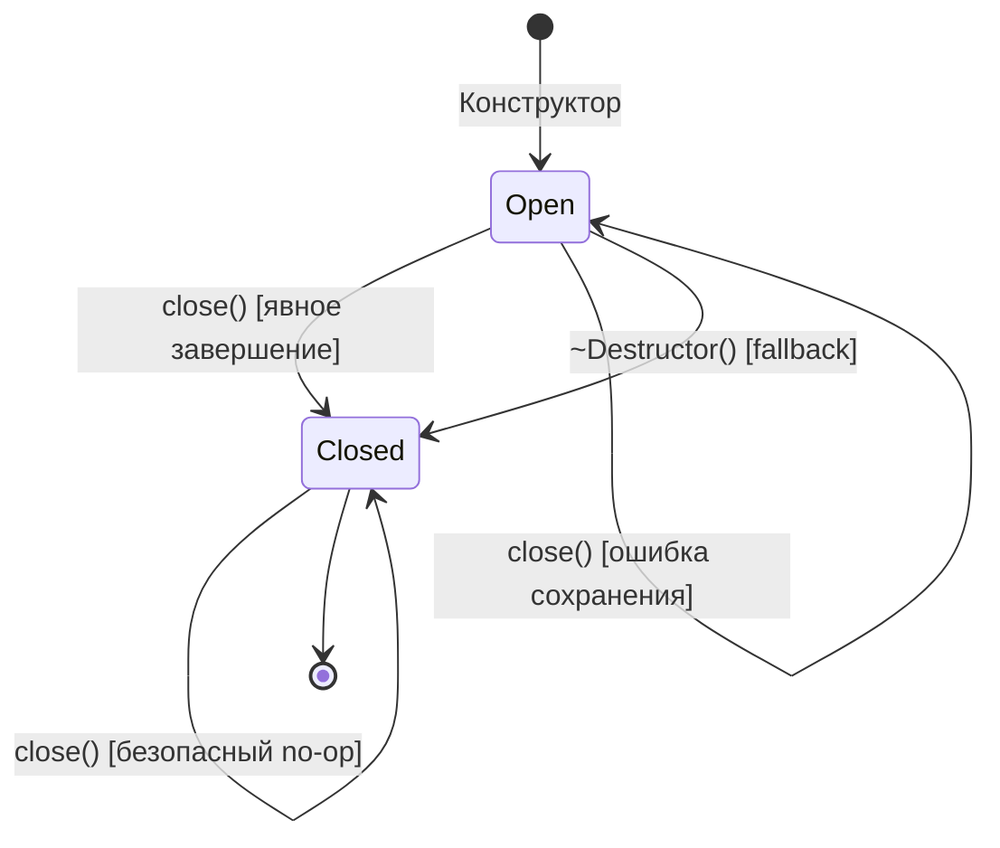

# Технические решения модуля storage

Статус: согласовано со спецификацией [spec.md](spec.md).
Основание: `specs/storage/spec.md`, `specs/ontology/spec.md`, `AGENTS.md`.
Целевая платформа — Linux, Raspberry Pi 4b 8/120 (SD-card), приложение C++17.

## 1. Цели и границы

Модуль `storage` хранит инвентарь устройств, сопоставляя локальные идентификаторы
`DeviceId` с физическими идентификаторами и драйверами.
Публичный интерфейс — `IDeviceStorage`. Реализации:
- `InMemoryDeviceStorage` — энергозависимое хранилище в RAM для тестов.
- `SQLiteDeviceStorage` — постоянное хранилище на базе SQLite.

Модуль предоставляет:
1. Синхронный атомарный снимок открытой базы в файл: `dumpToFile(path)`.
2. Явный метод завершения работы: `close()`.
3. Опциональный финальный автодамп при закрытии объекта (`dump_path`).

Модуль не хранит значения возможностей, граф связей и комнаты; фоновых потоков
и внутренних мьютексов модуль не создаёт.

## 2. Жизненный цикл и состояния

Хранилища реализуют модель двух состояний: `Open` и `Closed`.



### 2.1. Состояние Open
- Экземпляр готов к обслуживанию операций `insert`, `findByPhysicalId`, `getAll`, `dumpToFile`.
- Для `SQLiteDeviceStorage`: дескриптор `sqlite3*` открыт и указывает на рабочую базу.
- Для SQLite состояние определяется самим дескриптором: `database != nullptr`
  означает `Open`, `nullptr` — `Closed`. Отдельный дублирующий флаг не нужен.
  InMemoryDeviceStorage хранит флаг `closed_`.

### 2.2. Переход close()
1. Если хранилище уже находится в состоянии `Closed`, метод немедленно возвращает управление (идемпотентность).
2. Для `SQLiteDeviceStorage`:
   - Если задан `dump_path`, синхронно вызывается `dumpToFile(dump_path)`;
     предшествующий явный dump не отменяет финального сохранения.
   - Соединение с базой данных закрывается через `sqlite3_close_v2(database)`.
   - После успешного закрытия указатель `database` обнуляется (состояние `Closed`).
   - Любая ошибка сохранения или закрытия базы выбрасывается наружу как `std::runtime_error`.
3. Для `InMemoryDeviceStorage`:
   - Состояние устанавливается в `closed_ = true`.

При ошибке dump соединение остаётся открытым: чтение и вставка доступны,
а повторный `close()` заново сохраняет текущее состояние. Это относится также
к ошибке fsync каталога после rename. Ставшее недопустимым назначение автодампа
преобразуется из `invalid_argument` в `runtime_error` на границе `close()`.
Ошибка явного вызова передаётся без логирования.

### 2.3. Состояние Closed
- Любые обращения к операциям хранилища (`insert`, `findByPhysicalId`, `getAll`, `dumpToFile`) выбрасывают `std::logic_error` ("Storage is closed").
- Приватный `ensureOpen()` проверяет состояние в начале каждой операции,
  до проверки аргументов, доступа к SQLite и файлам.
- Повторный вызов `close()` безопасен и не выбрасывает исключений.

### 2.4. Деструктор как noexcept fallback
- Согласно `AGENTS.md`, деструктор не выпускает исключений.
- Если объект уничтожается без предварительного вызова `close()`, деструктор выполняет `close()` внутри блока `try-catch`.
- При возникновении ошибки автодампа деструктор подавляет исключение и однократно логирует диагностическое сообщение через `logging::log` на уровне `Error`.
- Если объект уже был закрыт вызовом `close()`, деструктор ничего не делает.
- После неудачного явного `close()` деструктор выполняет последнюю попытку.
  При неудаче этой попытки соединение освобождается независимо от сохранения.

## 3. Атомарный dump в файл

Метод `dumpToFile(const std::string &path)` сохраняет всю базу данных `main` в указанный путь:
1. Валидация пути: непустой, без NUL, обычный файл или новое имя, родитель существует, не ссылается на открытую рабочую базу.
2. Создание уникального временного файла в родительском каталоге назначения (`mkstemp`).
3. Сброс состояния базы через SQLite backup API (`sqlite3_backup_init`, `sqlite3_backup_step`, `sqlite3_backup_finish`).
4. Принудительный перевод временной базы в режим журнала `DELETE` (`PRAGMA journal_mode=DELETE;`), чтобы снимок не зависел от WAL-файлов.
5. Закрытие соединения с временной базой.
6. `fsync` дескриптора временного файла.
7. Атомарный `rename` временного файла поверх файла назначения.
8. `fsync` родительского каталога.

Операция оставляет открытую рабочую базу неизменной.
При ошибке до `rename` временный файл удаляется, прежний снимок сохраняется.
При ошибке после `rename` сообщает о неопределённости долговечности каталога.

## 4. Унификация с модулем Ontology

Интерфейсы `IDeviceStorage` и `IOntologyStorage` предоставляют идентичные методы сброса и завершения:
```cpp
virtual void dumpToFile(const std::string &path) = 0;
virtual void close() = 0;
```
Оба модуля:
- Используют идентичный 6-этапный протокол публикации снимка на диск.
- Не содержат фоновых потоков и таймеров периодического сброса.
- Поддерживают опциональный `dump_path` для финального автодампа в `close()`.
- Идемпотентно обрабатывают повторный `close()` и отклоняют операции после закрытия через `std::logic_error`.
